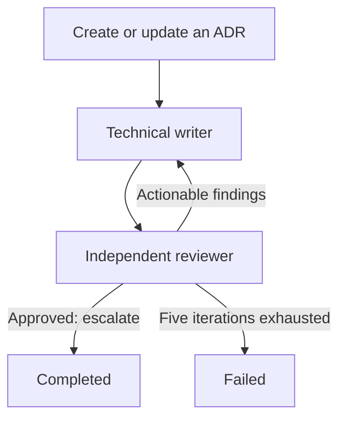

# Balda ADR maintenance agent pack

This project-local Callee pack creates and updates architecture decision
records through a bounded writer-reviewer loop. It is tailored to Balda's ADRs
under `docs/architecture/adr/` and their navigation in
`docs/architecture/index.md`.

## Workflow



The writer may create a new ADR, correct or amend an existing ADR, or record a
replacement through explicit supersession. The reviewer reads the actual files
and repository evidence without editing. Only the reviewer can escalate and
finish the Loop. The Loop fails if five iterations do not produce an approved
result.

## Pack contents

| Resource | Responsibility |
| --- | --- |
| `adr-maintenance/roles/technical-writer` | Creates or maintains ADR files and ADR index navigation. |
| `adr-maintenance/roles/reviewer` | Reviews evidence, completeness, history, links, and architecture consistency without editing. |
| `adr-maintenance/workflows/maintain-adr` | Repeats writing and review until approval or exhaustion. |

Both roles use supervised one-shot Codex sessions with `permissions: ask`.
Running the workflow therefore requires an authenticated Codex installation
and a controlling terminal.

## Inspect

```bash
callee agent validate .callee/adr-maintenance/roles/technical-writer.md
callee agent validate .callee/adr-maintenance/roles/reviewer.md
callee agent validate .callee/adr-maintenance/workflows/maintain-adr.md
callee agent view adr-maintenance/workflows/maintain-adr --json
```

If `callee` is not installed globally, use the pinned project-authoring
fallback:

```bash
npx --yes @baldaworks/callee@0.22.1 agent view \
  adr-maintenance/workflows/maintain-adr --json
```

## Run

Create a new ADR:

```bash
callee agent run adr-maintenance/workflows/maintain-adr \
  --message "Create a proposed ADR for <decision>. Ground it in the current implementation and architecture contracts."
```

Update an existing ADR:

```bash
callee agent run adr-maintenance/workflows/maintain-adr \
  --message "Update ADR 0003 with the verified implementation status and consequences of <change>. Preserve the original decision history."
```

For a material replacement, state that explicitly. The writer will create a
new ADR and link the old and new records instead of silently changing an
accepted decision's core contract.
