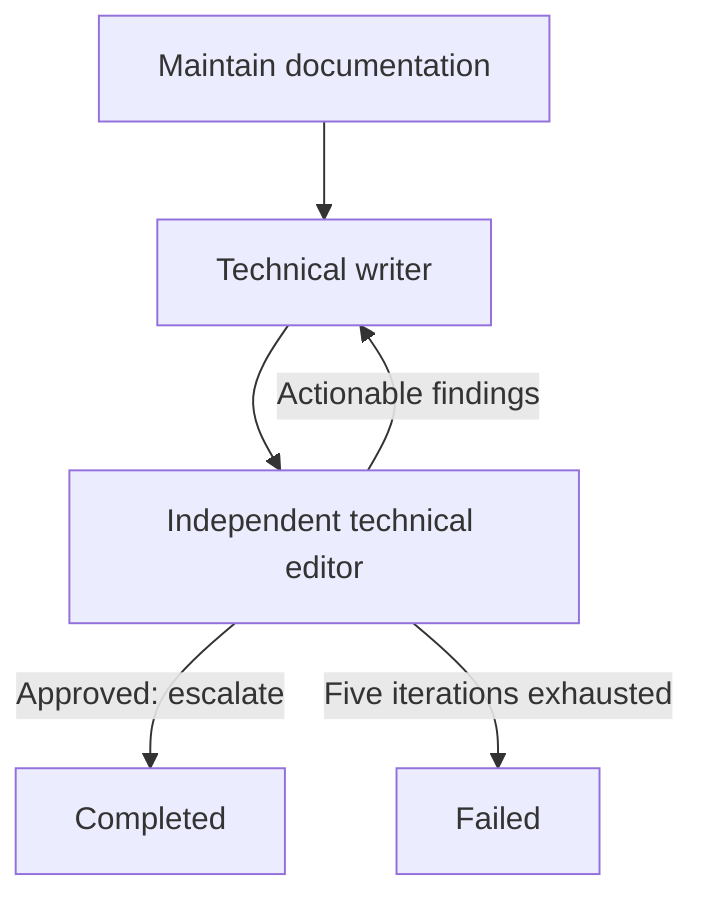

# Balda documentation maintenance agent pack

This project-local Callee pack maintains repository documentation through a
bounded technical-writer and editor loop. The writer changes documentation from
verified repository evidence. The independent editor remains read-only and
finishes the workflow only after every material finding is resolved.

## Workflow



The Loop preserves the original maintenance request in both role inputs and
feeds the previous editorial review back to the writer. Only the editor may
escalate and complete the Loop. Exhausting five iterations fails the run rather
than treating an unapproved draft as complete.

## PromptKit foundation

The role foundations were generated through Callee's embedded PromptKit catalog
and then specialized for Balda documentation:

- `maintenance-workflow` supplied the writer's evidence, change-propagation,
  self-verification, and iterative-refinement foundation;
- `review-code`, configured for Markdown and repository documentation, supplied
  the editor's evidence-based review and structured-remediation foundation.

The catalog has no dedicated technical-writer or technical-editor persona, so
both foundations were generated with the closest available
`software-architect` persona. Specialization replaced the templates'
software-specific task sections with concise repository-specific documentation
contracts while preserving their relevant review principles. Both roles use
supervised one-shot Codex sessions with `permissions: ask`.

## Pack contents

| Resource | Responsibility |
| --- | --- |
| `doc-maintenance/roles/technical-writer` | Updates only the documentation required by the request. |
| `doc-maintenance/roles/editor` | Reviews the actual diff and evidence without editing files. |
| `doc-maintenance/workflows/maintain-docs` | Repeats writing and editing until approval or exhaustion. |

## Inspect

```bash
npx --yes @baldaworks/callee@0.22.1 agent validate \
  .callee/doc-maintenance/roles/technical-writer.md
npx --yes @baldaworks/callee@0.22.1 agent validate \
  .callee/doc-maintenance/roles/editor.md
npx --yes @baldaworks/callee@0.22.1 agent validate \
  .callee/doc-maintenance/workflows/maintain-docs.md
npx --yes @baldaworks/callee@0.22.1 agent view \
  doc-maintenance/workflows/maintain-docs --json
```

## Run

```bash
npx --yes @baldaworks/callee@0.22.1 agent run \
  doc-maintenance/workflows/maintain-docs \
  --message "Update <document> for <verified change>. Preserve existing navigation and verify every changed link."
```

The workflow requires an authenticated Codex installation and a controlling
terminal for permission prompts.
