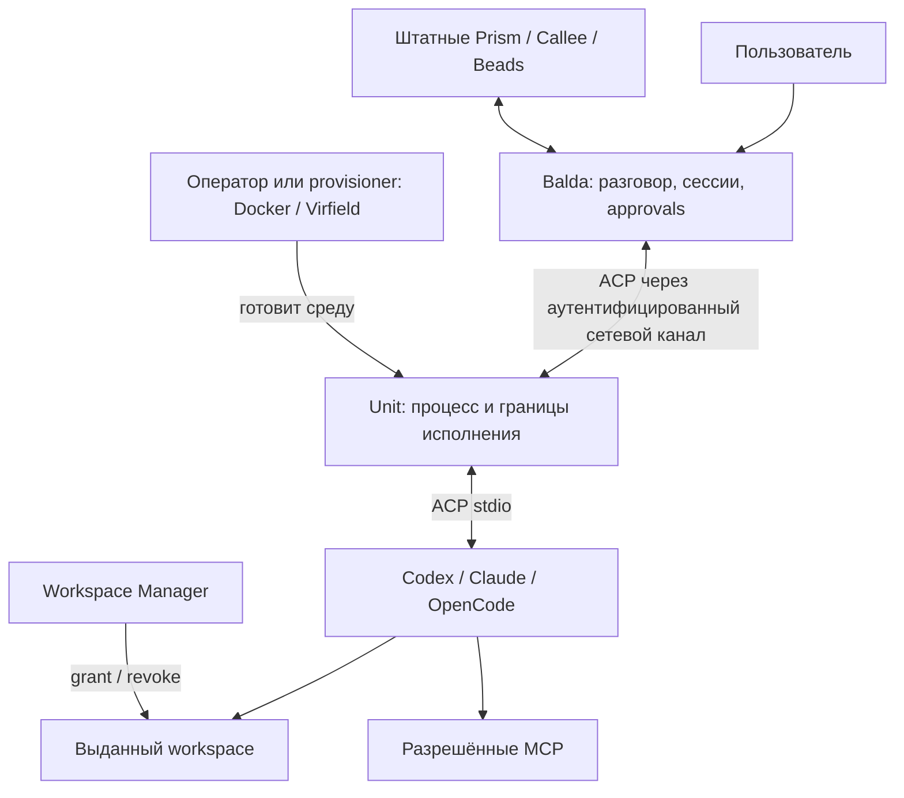

# ADR 0004: Balda Unit — remote ACP provider

- Status: Proposed
- Date: 2026-10-19
- Owners: Balda maintainers
- Decision scope: remote ACP execution, Unit inventory and admission, execution
  ownership, capacity, fencing, credentials, and cleanup
- Depends on: [ADR 0002: Backoffice-managed runtime providers](0002-backoffice-managed-runtime-providers.md)
  and [ADR 0003: YAML-first provider driver registry](0003-yaml-first-provider-driver-registry.md)
- Supersedes: none
- Approval: pending

Этот ADR расширяет ADR 0002 для удалённого исполнения; его `ProviderBinding`,
immutable revisions, full-graph validation, CAS и audit сохраняют силу. Он не
заменяет ADR 0001. Рабочее deployment-название Unit — `balda-unit`; название
продукта, форма поставки и upstream-интеграция требуют согласования с
мейнтейнером Balda.

Один Unit представляет ровно один ACP process instance и одно активное
соединение с Balda. `initialize` выполняется один раз для этого соединения, после
чего instance обслуживает несколько независимых ACP session IDs. Binding
соответствует ACP-сессии, а не отдельному процессу. Дополнительные сущности
`AgentInstance`, `SessionAttachment`, `agent_instance_id` и `attachment_id` в
контракт не вводятся.

## Проверенное состояние репозитория

На момент рассмотрения 2026-10-19 Unit ещё не реализован. Этот ADR описывает
предлагаемый контракт и будущую реализацию, а не существующее поведение.

- [`SessionRecord`](../../../internal/apps/balda/state/types.go) не содержит
  Unit-specific полей. Из provider/runtime pins он хранит только существующие
  `ProviderBindingJSON` и `RuntimeSnapshotID`.
- [SQLite migration 67](../../../internal/apps/balda/state/migrations/00067_managed_providers.sql)
  и [PostgreSQL migration 32](../../../internal/apps/balda/state/postgres_migrations/00032_managed_providers.sql)
  добавляют существующий inline provider binding рядом с runtime snapshot;
  отдельного Unit execution store в текущей схеме нет.
- [`providers`](../../../internal/apps/balda/providers) остаётся единственным
  сервисом managed provider state и выдаёт secret-free inventory; его текущие
  типы и tests не содержат Unit registration или Unit authentication.
- [`go.mod`](../../../go.mod) закрепляет
  `github.com/normahq/go-adk-acpagent/v2` v2.6.1. Его `Client` управляет одним
  ACP subprocess и несколькими ACP session IDs; upstream test создаёт на одном
  Client две сессии и выполняет concurrent prompts с раздельными updates и
  результатами. Это подтверждает protocol/client model, но не реализацию Unit
  или заявленную профилем production capacity.
- Текущий [`RuntimeForSession`](../../../internal/apps/balda/agent/runtime_manager.go)
  намеренно создаёт отдельный локальный ACP process/runtime на Balda session,
  потому что его MCP headers статичны на lifetime процесса. Это ограничение
  текущего host adapter, а не инвариант ACP или целевой Unit model.
- [Backoffice client metadata](../../../internal/apps/backoffice/security/client.go)
  использует direct connection peer и игнорирует forwarded address headers,
  поскольку trusted proxy chain сейчас не настроена. Unit-specific WebSocket
  authentication и forwarding contract из этого ADR ещё отсутствуют.
- [`cmd/balda`](../../../cmd/balda) остаётся единственным executable этого
  репозитория по [`AGENTS.md`](../../../AGENTS.md). Этот ADR не утверждает
  размещение второго `cmd/*` executable.
- Текущие правила слоёв оставляют session lifecycle в `session`, storage/read
  models в `state`, runtime policy и host wiring в `execution`, а новые
  application use cases должны зависеть от небольших портов и composition-root
  adapters; см. [architecture layers](../layers.md) и
  [application sub-zones](../application-zones.md).

## 1. Предлагаемое решение

Создать небольшой исполнитель **Unit**, который запускается
в среде агента, подключается к Balda и предоставляет ей обычного ACP-провайдера.
Balda управляет агентскими сессиями и ходом работы. Unit отвечает за запуск
процесса, применение локальной политики, передачу ACP и завершение своей среды.

Реализация должна сохранять штатные контракты Balda и ACP и иметь минимальный
набор обязательных компонентов. Реализационные инварианты процессов, ресурсов
и credentials описаны в разделе 14.
Этот ADR описывает целевое решение, а не готовую реализацию Unit. Он расширяет
принятые ADR 0002/0003; принятие зависимостей не считается доказательством, что
их реализация уже завершена в конкретной установленной версии Balda.

Целевой пользовательский сценарий:

1. Оператор подготавливает контейнер, VM или учётную запись на хосте с агентом.
2. Администратор заранее создаёт Unit в Backoffice. Balda один раз показывает
   высокоэнтропийный bearer token вида `<public_lookup_id>.<secret>` и сохраняет
   только его криптографический digest.
3. Оператор запускает Unit с адресом интеграции Balda, локальным профилем и
   bearer token, переданным через защищённый канал. Unit открывает исходящий
   WebSocket over TLS и предъявляет token в `Authorization: Bearer`.
4. Balda аутентифицирует заранее созданный Unit, проверяет server-owned policy,
   enabled/revoked state и назначает соединению свежий generation. После этого
   Balda выполняет ACP `initialize` и выводит readiness из состояния соединения.
   Unit не публикует profiles или readiness; создание Unit и подключение сами по
   себе не создают провайдера.
5. Администратор через штатный provider service создаёт managed-provider revision,
   ссылающуюся на `(unit_id, profile_id, profile_revision)`, и явно включает её
   в требуемый provider graph.
6. Сессия сохраняет только обычные `ProviderBinding` и `RuntimeSnapshotID`.
   При построении remote runtime provider driver передаёт отдельному Unit
   execution service непрозрачную неизменяемую область владельца и точную
   provider revision; admission и assignment не входят в состояние сессии.
7. Агент работает в выбранной среде; пользователь получает обычные сообщения,
   запросы разрешений и результат через Balda.

URL определяет только адрес подключения. Bearer token передаётся исключительно
в заголовке WebSocket upgrade и не помещается в URL или query.

## 2. Контекст и проблема

Balda должна работать с ACP-агентами в отдельных контейнерах, на физических
хостах и в VM через единый интерфейс провайдера. Место запуска агента не должно
менять пользовательскую модель сессии, подтверждений и получения результата.

Штатный ACP agent bridge обычно общается с клиентом через stdio. Передача этого
потока через SSH позволяет подключить подготовленный хост, но сама по себе
не решает регистрацию исполнителя в Balda, server-owned policy, управление
ёмкостью и обработку перезапуска удалённой среды.

Целевой сценарий — launcher, который оператор запускает рядом с агентом,
передав URL интеграции Balda. Launcher подключается, а в административном
интерфейсе появляется исполнитель. Публикация его как провайдера отдельно следует
управляемому provider contract ADR 0002. Для такого сценария нужно определить:

- управляемое создание, аутентификацию, readiness, ротацию token и отзыв Unit;
- двусторонний ACP-транспорт и точную маршрутизацию binding к ACP session ID
  единственного process instance Unit;
- удалённый workspace, достижимые MCP и границы локальных полномочий;
- отмену, потерю связи, восстановление и доказанную очистку ресурсов.

Эти обязанности объединяются в Unit. Планирование работы и пользовательские
подтверждения остаются у Balda; подготовка инфраструктуры и выдача папок имеют
отдельных владельцев. Наличие протокольного подключения не считается приёмкой
модельной работы или полного workflow.

## 3. Цели и границы

### Цели

- Один центр управления разговором, агентскими сессиями и пользовательскими
  подтверждениями — Balda.
- Прямое использование штатных Codex, Claude и OpenCode ACP bridges.
- Одинаковая модель подключения для подготовленного Linux-контейнера,
  macOS-хоста и VM, с честно различающимися гарантиями изоляции.
- Запуск рядом с агентом без необходимости давать ему Docker socket,
  административный SSH-доступ или полномочия оператора.
- Явный Unit profile для process-wide модели, agent identity и credentials;
  явные workspace, MCP, prompts и permissions для каждой ACP-сессии.
- Понятные отмена, потеря связи, перезапуск и очистка без повторения действий
  агента с неизвестным исходом.
- Использование проверенных подходов к процессам, ресурсам и хранению состояния
  без зависимости от чужой модели задач и форматов данных.

### За пределами обязательного Unit

- Собственный планировщик задач, workflow engine или копия Prism/Callee.
- Собственная Story/Task модель и отдельная проекция Beads.
- Собственный чат-бот, рендеринг approval forms или параллельный Human API.
- Обязательный сервис артефактов, Git cache, автоматическая публикация PR,
  миграция окружения посреди workflow и перенос произвольного состояния агента.
- Самостоятельный выбор другой модели при отказе выбранной.
- Исполнение команд на третьем хосте через общий «remote shell» агента.
- Перенос macOS workload в Linux-контейнер с обещанием нативного macOS поведения.
- Автоматическое переключение существующих сессий или удаление работающих служб
  при регистрации нового Unit.

Эти функции могут существовать отдельными расширениями, если для них появится
конкретный сценарий. Они не являются предпосылками первой ACP-сессии.

## 4. Слои и владельцы состояния



### Balda

Владеет пользовательской сессией, назначением провайдера, выбором модели,
контекстом работы, разрешениями и доставкой результата. Provider service
сохраняет единый configured/managed namespace, валидирует полный граф и управляет
неизменяемыми ревизиями по ADR 0002. Driver registry остаётся единственным
реестром типов и правил разрешения по ADR 0003.

Разделяются два состояния сессии и отдельное execution-состояние:

- `ProviderBinding` — существующее значение в состоянии сессии: root provider
  и точные ordered entries `(provider_id, source, revision_id)`.
- `RuntimeSnapshotID` — независимый pin runtime-catalog для commands, hooks,
  skills и MCP; он не хранит provider definitions или их ревизии.
- `UnitExecutionRecord` — assignment, admission, reservation, connection
  generation и terminal state в отдельном Unit execution store. Эта запись не
  является частью session schema и недоступна пакету `session`.

`ProviderBinding` не получает нового ID или отдельной binding table.
`binding_id` существует только как внутренний ключ `UnitExecutionStore` для
конкретной ACP-сессии; в wire ACP используется стандартный `sessionId`. На границе
построения runtime execution service
получает точную entry binding и непрозрачный `owner_scope`, идентифицирующий
неизменяемое время жизни разговора. Он не читает и не изменяет `SessionRecord`.
Пакет `session` не знает о Unit, connection generation, admission или binding
lifecycle.

### Штатные Prism, Callee и Beads

Сохраняют свои контракты ролей, фаз и задач. Unit предоставляет исполнителя
агентской сессии и не запускает Callee workflow как обязательную оболочку вокруг
каждого запроса. Интеграцию этих компонентов с удалённым провайдером требуется
проверить отдельно: наличие рабочего ACP-транспорта её не доказывает.

### Unit

Владеет одним ACP-процессом, его process group, одним активным ACP connection и
техническим журналом сессий. Process instance однозначно определяется tuple
`(unit_id, profile_revision, connection_generation)`; каждый binding связывается
со своим `acp_session_id`, `owner_scope`,
рабочим каталогом, MCP и ограничениями исполнения. В журнале нет собственной
модели бизнес-задач или очереди Story.

### Unit execution service

Прикладной execution-контур Balda владеет inventory Unit, assignments,
admission, согласованием ёмкости, connection-generation fencing и cleanup
state. Он хранит их отдельно от session state и получает от composition
boundary только непрозрачный неизменяемый `owner_scope`, exact provider revision
и execution request. Сервис не читает и не изменяет session records. Provider
driver является его клиентом; session lifecycle не импортирует Unit-контракты
и не координирует их переходы.

### Workspace Manager

Владеет выдачей конкретного каталога конкретному получателю, RO/RW, сроком
доступа и фактическим отзывом. Discovery корня не означает доступ к его файлам.
Unit использует выданный grant и не создаёт второй независимый workspace lease.
Его собственный срок binding может только дополнительно ограничивать запуск.

### SSH Manager и provisioner

SSH Manager остаётся средством подготовки и проверки SSH-доступа к существующим
хостам. Для постоянно подключённого Unit SSH не требуется как канал ACP.
Docker/Virfield provisioner, если используется, подготавливает среду и может
установить или запустить Unit. Его административные полномочия находятся за
пределами процесса агента.

### Граница ответственности

Один ресурс имеет одного владельца: сессию назначает Balda, процесс завершает
Unit, workspace отзывает Workspace Manager, VM освобождает её provisioner.
Нижний слой сообщает фактическое состояние; верхний не подменяет отсутствие
подтверждения оптимистичным `success`.

## 5. Где выполняются агенты и субагенты

Unit размещается в той же среде исполнения, где запускается его ACP-агент:

- В подготовленном Linux-контейнере Unit и agent bridge работают внутри этого
  контейнера. Исходники доступны через разрешённый mount или подготовленный
  локальный workspace.
- На macOS Unit запускает agent bridge под принятой Seatbelt-политикой.
- В macOS VM Unit работает внутри гостевой ОС; Virfield управляет самой VM.

ACP process и ACP session имеют разные lifetimes. Unit запускает ровно один ACP
process instance и выполняет `initialize` один раз для его активного connection.
После этого `session/new` создаёт независимые ACP-сессии на том же instance;
`session/load` и `session/resume` используются только при объявленных
capabilities. Каждый binding получает собственные `owner_scope` и ACP session
ID, но не отдельный процесс.

Профиль объявляет проверенные `max_sessions` и `max_concurrent_prompts` одного
Unit. Session-scoped `cwd` и MCP configuration передаются в ACP session setup.
Если конкретный agent/backend не обеспечивает изоляцию session-scoped данных,
он не может использоваться как Unit до прохождения cross-session acceptance.

Субагент, которого Balda назначила Unit-провайдеру, выполняется на этом Unit.
Вложенный процесс или внутренний субагент самого Codex/Claude остаётся в той же
среде и наследует её ограничения. Запуск на другом Unit требует отдельного
назначения Balda; текст prompt или само слово «субагент» не меняют размещение.

Модель может обслуживаться внешним API, но файловые операции, shell-команды и
локальные инструменты исполняются в среде агента. Сетевые MCP выполняют свою
работу на стороне соответствующего MCP-сервиса.

## 6. Подключение и регистрация Unit

Это **новый совместный контракт Balda и Unit**, а не существующий API Balda.
Конкретные URL paths, schema, названия provider types и номера версий wire
protocol должны быть согласованы до реализации. Ниже определены требования
к поведению, а не объявлен готовый endpoint.

### Создание и первичное подключение

1. Администратор создаёт Unit в Backoffice до запуска Unit. Операция создаёт
   стабильный `unit_id`, server-owned policy и состояние `enabled`.
2. В приватном `no-store` ответе Balda ровно один раз показывает
   высокоэнтропийный bearer token формата `<public_lookup_id>.<secret>`.
   `public_lookup_id` нужен только для поиска записи и не является
   аутентификатором. Balda сохраняет public lookup ID, криптографический digest
   token secret и необходимую служебную metadata, но не plaintext token или
   secret.
3. Оператор передаёт Unit integration URL и token через защищённый ввод,
   secret file или secret mount. Token не передаётся аргументом CLI и не
   наследуется запускаемым agent process.
4. Unit открывает исходящий WebSocket over TLS и посылает
   `Authorization: Bearer <public_lookup_id>.<secret>` в HTTP upgrade. Token не
   помещается в URL, query, cookie, WebSocket subprotocol или первое сообщение.
5. До upgrade Balda находит заранее созданный Unit по public lookup ID,
   криптографически проверяет secret по сохранённому digest, проверяет, что Unit
   enabled и не revoked, и применяет server-owned policy. Присланные клиентом
   или proxy forwarded identity headers не участвуют в identity или policy.
6. Для принятого соединения Balda атомарно назначает свежий монотонный
   connection generation. Новый принятый generation fence-ит прежнее соединение
   и все его поздние сообщения. Затем Balda и Unit выполняют стандартный ACP
   `initialize`; до успешного ответа session methods не допускаются.

Создание Unit и подключение не изменяют provider
definitions, provider graph или `provider_state_version`. Token является
единственным credential Unit для WebSocket-аутентификации: отдельные enrollment
credentials, asymmetric key pairs, challenge-response, message signatures и
вторая persistent identity credential не используются.

Rotation и revocation — явные операции Backoffice. Rotation генерирует новый
token, показывает его один раз, атомарно заменяет digest и fence-ит текущее
соединение; прежний token больше не принимается. Revocation fence-ит соединение,
запрещает новые подключения и admissions и не отменяется reconnect. Возврат в
эксплуатацию требует явной принятой административной операции; reconnect её не
заменяет.

### Граница TLS и reverse proxy

Публичный TLS завершается на доверенном reverse proxy. Proxy обязан передавать
`Authorization` в Balda без удаления или подмены. Участок proxy → Balda проходит
по loopback, защищённой сети или отдельно защищённому transport. Balda игнорирует
forwarded identity headers, включая заголовки, которые заявляют Unit, user или
роль: bearer token и server-owned state являются единственным основанием
аутентификации и авторизации Unit.

Reverse proxy входит в trust boundary этого решения, потому что видит bearer
token после TLS termination. Если proxy находится вне доверенной границы и
участок до Balda отдельно не защищён, этот ADR не заявляет end-to-end
confidentiality. Такой deployment требует другого принятого transport или
дополнительной защиты вне этого решения.

### Server-owned configuration и managed providers

Unit не публикует по ACP socket собственные profiles, capacity, readiness,
shell command, image, host paths или Docker flags. `UnitRegistration` содержит
стабильный `unit_id`, public lookup ID, lifecycle state, текущий connection
generation и server-owned configuration единственного ACP process: профиль,
revision, лимит sessions и лимит concurrent prompts. Digest и token не входят в
inventory projection. Readiness выводится из `enabled` state, живого WebSocket и
успешного ACP `initialize`.

Managed provider создаётся отдельным явным действием администратора через
существующий provider service. Его immutable revision содержит публичную typed
`ProviderDefinition` с `(unit_id, profile_id, profile_revision)`, canonical driver
type и `ContractVersion`; protected values сохраняются по ADR 0002. Reconnect
не создаёт такую revision и не заменяет pins действующих сессий. Изменение
server-owned executable, image, policy или limits требует новой Unit profile
revision через Backoffice; Unit не может изменить её сетевым сообщением.

Для этого нужен встроенный remote ACP driver в registry ADR 0003. Рабочее имя
`unit_acp` не является готовым API. Descriptor задаёт typed config, passive
validation, normalization, environment policy и immutable identity fields.
Для первого инкремента canonical type, `unit_id`, `profile_id` и
`profile_revision` считаются immutable identity: их смена требует нового
provider ID. Более гибкие изменения допускаются только отдельным уточнением
контракта driver. Unit не регистрирует исполняемый driver-код. Managed
`generic_acp`, произвольный `cmd` и command overrides не используются как обход
ограничений ADR 0002.

Каждая managed mutation выполняется одним путём:

1. Provider service читает согласованный `ReadProviderState` и
   `provider_state_version`.
2. Проверяет complete candidate graph, namespace collisions, references,
   immutable identity и driver contract. Ссылка на profile revision проверяется
   по server-owned Unit configuration; validation не запускает agent или probe.
3. Одной транзакцией записывает revision/lifecycle state, audit и увеличенный
   `provider_state_version` через CAS того же прочитанного state version.
4. При конфликте не оставляет частичных revision, graph edits или audit и не
   повторяет пользовательское решение как безусловную запись.

Глобальный `provider_state_version` остаётся единственным optimistic token для
provider mutations; Unit не добавляет собственный activation catalog, provider
cache или публикацию определений при reconnect. Runtime-readiness не
переписывает валидную definition. Offline исполнитель делает исполнение
недоступным, а не изменяет bound graph.

Админка показывает отдельно Units и Administration → Providers. Ready Unit
становится доступен агентской сессии только через
явно созданную revision и обычный provider graph. Страницы, чтение inventory,
managed mutations и startup compilation остаются пассивными: без initialize,
model discovery, authentication или model prompt.

### Состояния доступности

Административный lifecycle отделён от наблюдаемого состояния соединения.
`enabled` разрешает аутентификацию при действующем token и server-owned policy;
`revoked` запрещает подключения и новые admissions. Подключённый и initialized
enabled Unit может быть `ready`, `busy` или `draining`; без принятого свежего
connection generation он `offline`. Создание записи не даёт промежуточному `pending`
enrollment полномочий, потому что enrollment protocol отсутствует.

Регистрация, открытый порт, успешный `initialize`, успешная модельная работа и
полный lifecycle — разные уровни доказательства. UI не должен сводить их к
одному постоянному флагу «всё работает».

## 7. Сетевой транспорт и ACP

### Выбор для первой реализации

Предлагается одно исходящее WebSocket over TLS соединение Unit → Balda. Оно
позволяет запускать Unit за NAT без входящего порта к агенту. Balda остаётся
логическим ACP client, агент — ACP server, независимо от того, какая сторона
установила TCP.

После успешного upgrade WebSocket несёт обычные ACP JSON-RPC сообщения. Отдельный
`balda.unit.v1` envelope, разделение на control/data streams,
`agent_instance_id` и `attachment_id` не вводятся. ACP уже адресует независимые
сессии через `sessionId`; один socket Unit обслуживает все их запросы, ответы и
notifications. Отдельный WebSocket и credential на каждый binding не создаются.

В первой версии Unit lifecycle не добавляет сообщения в этот socket. Enable,
drain, rotate и revoke меняют server-owned state в Balda; Unit наблюдает их как
отказ в новых sessions или закрытие WebSocket. Inventory publication, remote
lookup и cleanup receipts по отдельному management protocol не входят в это
решение. Liveness
определяется WebSocket ping/pong; отдельный application heartbeat не требуется.

Reverse WebSocket — предлагаемый транспортный профиль интеграции. Он не
объявляется стандартным ACP web transport или готовой возможностью SDK.
Совместимость и окончательный wire profile проверяются в первом прототипе с
мейнтейнером. Если upstream выбирает совместимый Streamable HTTP, меняется
transport adapter при сохранении границ и lifecycle этого ADR.

### Аутентификация и connection fencing

WebSocket upgrade аутентифицируется ровно bearer token из раздела 6. Balda не
принимает token из query, cookie, subprotocol, body или forwarded identity
header. Проверка token, enabled/revoked state и server-owned policy происходит
до `101 Switching Protocols`; failure не создаёт connection generation и не
открывает доступ к inventory или ACP.

Принятому socket Balda атомарно назначает свежий connection generation и
связывает его с `unit_id`. Generation принадлежит самому соединению и не
добавляется в каждый ACP message: только текущий socket данного Unit может
доставлять ACP. Принятие нового соединения закрывает прежнее и запускает
reconciliation его admissions и sessions. Generation не является credential,
provider revision или ACP session ID и не позволяет подключиться без token.

Каждый принятый WebSocket является ровно одним ACP connection и соответствует
ровно одному ACP process instance Unit. На нём допускается ровно один
`initialize`; session methods до успешного initialize и повторный initialize
отвергаются. Reconnect закрывает старый socket, останавливает и reap-ит прежний
ACP process, затем создаёт новый process и выполняет новый `initialize`.
Существующие sessions не переносятся молча: `session/load` или `session/resume`
в новом generation возможны только при соответствующей ACP capability.

Перед `session/new` execution service проверяет exact owner, provider/profile
revision, admission и актуальный connection generation. Полученный session ID
durable связывается с binding и owner scope до первого prompt. ACP
маршрутизация использует этот session ID. Отдельных attach handshakes, nonce,
TTL или channel credential нет.

Rotation, revocation, policy denial, потеря WebSocket или принятие нового
соединения закрывают прежний socket. Поздние frames с него не могут создать
сессию, подтвердить permission или продолжить ACP.

### Почему одного JSON endpoint недостаточно

ACP использует двусторонний JSON-RPC. Через канал должны проходить запросы,
ответы и notifications в обоих направлениях, включая прогресс, permission
requests и отмену. Спецификация разрешает custom transport, сохраняющий формат
и lifecycle. Streamable HTTP в текущей спецификации отмечен как draft; Python
SDK имеет экспериментальные HTTP/WebSocket adapters. Это исходная техническая
возможность, а не доказательство совместимости с Go runtime Balda.

Unit соединяет сетевой поток с `stdin/stdout` штатного agent bridge. `stderr`
отделён от ACP и используется для ограниченных диагностических логов. Unit не
генерирует вместо агента модельные ответы и не переводит его события в
отдельные workflow events или промежуточные бизнес-сущности.
WebSocket и этот stdio bridge образуют один логический ACP connection; они
создаются и завершаются вместе для одного connection generation.

JSON-RPC IDs, notifications, ошибки и согласованные расширения сохраняются.
Версия ACP и capabilities согласуются через `initialize`. Неизвестная версия
интеграции, несовместимая обязательная capability или недостижимый transport
приводят к явному отказу до prompt. Нельзя молча сменить агента, модель или
перейти на другой транспорт с более широкими правами.

### Ограничения потока

Транспорт должен иметь ограниченные размеры сообщений и очередей, backpressure,
таймауты записи и корректное закрытие. Переполнение приводит к видимой ошибке
и завершению binding; потеря сообщений прогресса или permission request ради
продолжения работы недопустима. Лимиты задаются версией профиля и проверяются
до активации binding. WebSocket ping/pong обнаруживает потерю соединения, после
чего Unit применяет локальную cleanup policy. Полностью недоступная сеть всё
равно приводит к timeout и reconciliation, а не к обещанию мгновенной удалённой
отмены.

## 8. Создание и жизненный цикл binding

### Граница session и execution

Session contract остаётся ровно контрактом ADR 0002: `SessionRecord` хранит
`ProviderBinding` и независимый `RuntimeSnapshotID`. Он не содержит
`UnitAssignment`, Unit identity, token, connection generation, admission,
cleanup state или placement policy Unit. Пакеты session lifecycle не
импортируют Unit execution contracts и не выполняют переходы binding.

При построении runtime точная remote-provider revision из `ProviderBinding`
попадает в remote driver. Composition boundary также передаёт драйверу
`owner_scope` — непрозрачный стабильный идентификатор конкретного времени жизни
разговора. Unit execution service не знает `SessionRecord`, transport routing
или способ образования scope. Reset и новый conversational lifetime получают
новый scope; поздние JSON-RPC responses и frames прежнего scope не могут изменить
новое исполнение.

Remote driver обращается к `UnitExecutionService`. Сервис и отдельный
`UnitExecutionStore` владеют:

```text
owner_scope + selected_provider_id + provider_revision_id
unit_id + profile_id + profile_revision
connection_generation
binding_id + admission_id + canonical_request_digest
state + session/prompt reservations
acp_session_id + terminal_cleanup_state
```

Запись ссылается на retained provider revision, но не дублирует и не изменяет
provider graph. Для ordinary/reset, scheduled/webhook, pool,
goal/session-memory runtimes действует один driver/execution path. Consumer не
выбирает Unit из live inventory в обход bound graph.

Первая restore policy — `pinned_unit_profile`. Она следует из immutable remote
provider revision, содержащей `unit_id`, `profile_id` и `profile_revision`;
отдельного Unit pin в сессии нет. Restore той же `ProviderBinding` не выбирает
другой Unit или новую revision. Dynamic rescheduling под той же revision не
поддерживается.

### Авторитетная ёмкость и durable admission

Shared `UnitExecutionStore` Balda является авторитетным источником capacity для
ACP-сессий и concurrent prompts единственного process instance Unit. Session
slot резервируется до `session/new`, `session/load` или `session/resume`; prompt
slot — непосредственно перед каждым `session/prompt` и освобождается после
установленного terminal outcome. Журнал охватывает все sessions и prompts Unit
независимо от числа session rows, экземпляров Balda и reconnect.

До создания ACP-сессии Balda одной транзакцией:

1. проверяет generation, profile revision, cancellation fence и отсутствие
   другого payload для admission ID;
2. считает active и uncertain session reservations Unit;
3. создаёт уникальную session reservation и переводит binding в `opening` либо
   возвращает `capacity_exhausted` без `session/new`.

Уникальность admission/reservation и лимит проверяются в одной транзакции shared
store. Повтор exact request возвращает прежнюю reservation; тот же
admission с другим digest конфликтует. Reservation освобождается только после
durable terminal state и доказанной cleanup; `uncertain` удерживает slot.
Поэтому две конкурентные сессии не занимают один последний session slot, даже
если обе увидели одинаковое advisory readiness.

Перед `session/prompt` Unit execution service отдельной атомарной операцией
резервирует prompt slot для exact `(binding_id, owner_scope, acp_session_id)`.
На одной ACP-сессии
одновременно допускается не больше одного prompt; разные session IDs Unit могут
работать параллельно только до проверенного профильного лимита. Session
reservation не считается prompt reservation и не блокирует prompt capacity всё
время жизни сессии.

Unit execution service владеет этой shared capacity ledger и не объявляет slot
свободным до terminal transition. Если Unit недоступен, новый admission не
создаётся.

### Порядок открытия

1. Runtime восстанавливает exact bound graph по ADR 0002/0003, выбирает remote
   leaf в сохранённом порядке и передаёт driver непрозрачный `owner_scope`.
2. Unit execution service атомарно создаёт
   `UnitExecutionRecord(state=opening)` с `binding_id` и `admission_id` до
   remote side effect. Условие включает owner scope, provider/profile revisions,
   текущий connection generation и canonical request digest.
3. После commit remote driver отправляет стандартный ACP `session/new` на
   initialized WebSocket Unit с session-scoped `cwd` и MCP configuration, не
   отправляя prompt. При exact recovery `session/load` или `session/resume`
   допустимы только после capability check.
4. Полученный ACP session ID сохраняется в `UnitExecutionRecord`, после чего
   execution service условно переводит `opening → active`. Условие проверяет
   owner scope, admission, revisions, digest, connection generation
   и отсутствие конкурирующего cancel.
5. Только после commit `active` remote driver отправляет первый prompt.

Если commit шага 2 не состоялся, `session/new` не отправляется. Если соединение
теряется после отправки `session/new`, но до сохранения ответа, binding становится
`uncertain`: Balda закрывает generation, Unit останавливает прежний ACP process,
а все его sessions reconciles независимо. Запрос не повторяется автоматически.
Поскольку prompt ещё не отправлялся, это не повторяет модельный side effect.

### Точное восстановление и новый lifetime

Session restore загружает только `ProviderBinding` и `RuntimeSnapshotID`.
Runtime factory строит exact provider graph, а driver передаёт execution service
тот же opaque owner scope. Execution service сам reconciles принадлежащие scope
records. Session layer не загружает и не интерпретирует assignments.

Retained revisions работают после disable/tombstone по ADR 0002, но live policy
сохраняется: revoked Unit, недоступная profile revision или неподтверждённая
process identity запрещают исполнение.

Generation — fencing epoch Unit connection, а не provider revision. Он не
разрешает frame старого socket или предполагаемый resume. После доказанной
остановки execution service может создать новый assignment к той же exact
provider/profile revision и owner scope. ACP context переносится только при
принятой resume capability и reconciliation; prompt с неизвестным исходом не
повторяется.

Bounded fresh-session fallback ADR 0002 создаёт новый conversational lifetime,
новые pins и новый opaque owner scope. Старые records остаются только для
reconciliation/cleanup; их JSON-RPC responses и frames не проходят условия нового
scope. Старые `uncertain` reservations удерживаются до terminal cleanup.

### Состояния binding

В execution store: `opening → active → closing → closed`. `opening` не разрешает
prompt до `active`. Ошибки дают `failed`; неизвестный исход или
недоказанная остановка дают `uncertain` и удерживают capacity.

Binding закрывает владелец runtime при завершении owner scope, отмене, отзыве
или отказе. Session package не знает Unit command или state machine:
runtime/provider teardown вызывает общий driver close.

### Отмена и закрытие

При timeout, отзыве или teardown driver адресует стандартные ACP operations по
сохранённому session ID: `session/cancel` для активного prompt и
capability-gated `session/close`. Внутренний execution record fence-ится до
отправки операции. Без `session/close` запись остаётся закрытой для новых
prompts, а agent-side ресурсы учитываются до остановки Unit.

Ни одна операция binding не завершает здоровый ACP process Unit.
Отсутствие capability `session/close` само по себе не является причиной убить
его; профиль должен учесть retained session resources и при необходимости
перевести Unit в drain. Unit останавливает process group только при неисправности
ACP process, замене connection generation/reconnect, явном drain или отзыве
Unit. Тогда каждый binding независимо переходит в
`uncertain`/reconciliation по собственным owner scope, admission и ACP session
ID; cleanup или failure одной сессии не закрывает остальные.

Execution store durable сохраняет owner scope, generation и fence. Повтор close
возвращает прежний terminal state. После reconnect старый socket не может
продолжить binding. Если исход cancel/close неизвестен, запись остаётся
`uncertain` до остановки прежнего process generation; capacity раньше не
освобождается. Отдельный lookup или cleanup-receipt protocol в первой версии не
вводится.

## 9. Разрывы связи, часы и восстановление

При утрате WebSocket Balda прекращает новые назначения. Unit перестаёт принимать
новые bindings и незавершённые permission responses от старого соединения,
останавливает и reap-ит ACP process потерянного generation. Все bindings Unit
переходят в независимый reconciliation; прозрачное продолжение активного prompt
не обещается. Новый generation не принимается, пока процесс предыдущего
generation не остановлен и не собран.

Запрос, записанный в соединение без полученного ответа, может иметь неизвестный
исход. Его нельзя автоматически отправлять новому агенту или воспроизводить
после reconnect. Транспортный reconnect и resume модельной сессии — разные
операции. Resume разрешён только для согласованной capability конкретного
агента после reconciliation и привязки к прежней области доступа. Pins и
правила fresh-session fallback определены разделом 8 и ADR 0002; подбор другого
Unit на restore в этот контракт не входит.

После перезапуска Unit не считает старые PID доказательством живого процесса.
Нужны проверяемая process/container identity и connection generation; оставшиеся ресурсы
сначала обнаруживаются и останавливаются либо изолируются в `uncertain`.
Повторный запуск процесса не обозначается восстановлением прежнего исполнения.
После рестарта Balda существующие bindings также требуют reconciliation.

Упаковка Unit должна предусматривать остановку потомков при смерти самого Unit.
В контейнере это проверяется вместе с lifecycle контейнера; на нативном хосте —
с принятой политикой системного supervisor и последующим reconciliation.
Одна process group без такого механизма не гарантирует cleanup после падения
родителя. Если bounded остановку обеспечить нельзя, профиль не объявляется
готовым для автономной работы. Проверяется именно аварийная смерть процесса,
а не только обработанный сигнал корректного завершения.

WebSocket ping/pong timeout измеряется монотонными часами каждой стороны. На
reconnect сроки не продлеваются неявно. Срок workspace определяет его владелец.
Для внешних абсолютных сроков требуется определённая политика рассинхронизации;
timestamps разных машин не сравниваются как порядок событий.

## 10. Workspace и файловые операции

Для каждого binding должны быть явно согласованы grant, получатель, режим
доступа и путь в среде Unit. Типовые варианты — доступ к исходным файлам через
выданный SMB grant либо заранее подготовленный локальный checkout. Это разные
семантики; Unit не заменяет одну другой скрытым копированием проекта.

Один изменяемый checkout не выдаётся нескольким исполнителям без явной политики
координации. Для параллельных изменений назначаются разные worktrees/workspaces;
их подготовка относится к владельцу рабочего процесса или workspace.

В ACP передаётся абсолютный `cwd`, существующий в среде агента. Balda adapter
должен различать локальный и удалённый `cwd`: локальная проверка `os.Stat`
не должна требовать существования удалённого пути внутри контейнера Balda.
Вместо неё удалённый путь проверяется Unit в пределах выданного grant.
Один `cd` в launcher не заменяет корректный `session/new.cwd`.

Разрешение путей, дополнительные каталоги, symlinks и mount boundaries проверяет
принимающая среда. Текст задачи и репозиторий не могут расширить grant. Изменение
прав или истечение срока прекращает соответствующий доступ, включая открытые
дескрипторы в пределах гарантий выбранного backend.

ACP client callbacks требуют отдельной проверки. Если агент запрашивает
файловые или terminal операции у клиента, такие операции должны выполняться
в среде назначенного Unit и в той же песочнице. Для неподдержанного callback
объявляется отсутствие capability либо возвращается явный отказ. Выполнение
на хосте Balda в качестве fallback запрещено. Transport adapter не должен
размывать место исполнения за счёт стандартных клиентских обработчиков.

## 11. MCP, инструменты и credentials

MCP-конфигурация формируется Balda для конкретного назначения. Профиль Unit
ограничивает допустимые подключения и возможности. Agent-side MCP endpoint
должен быть достижим именно из среды агента: `localhost` контейнера Balda или
случайно открытый локальный порт не являются рабочим удалённым адресом.

Допустимые варианты — внутренний service address общей Docker-сети либо
аутентифицированный scoped proxy. Контракт proxy фиксирует binding, срок и
разрешённые операции. Произвольный проброс localhost и широкое отключение
проверок hostname не входят в решение. Stdio MCP запускается в среде Unit
из разрешённого профиля; команда stdio MCP не исполняется на Balda по ошибке.

Инструменты выдачи доступа, регистрации хостов и управления инфраструктурой
остаются у управляющей стороны, если отдельно не разрешена ограниченная роль.
Запуск удалённого агента не означает передачу ему токенов SSH Manager,
Workspace Manager, Docker/Virfield администратора или административного API Balda.

Нужно различать:

- bearer token Unit для аутентификации WebSocket Balda;
- process-wide credentials модельного провайдера внутри среды агента;
- scoped MCP credentials конкретного binding;
- credentials инфраструктуры и файловых shares у их владельцев.

Для MVP модельная авторизация подготавливается оператором локально в изолированном
agent home или через существующий принятый credential helper. Unit сообщает
`authentication_required`, если её нет. Сетевой ACP transport не должен
незаметно устанавливать, копировать или менять личные credentials оператора.
Agent home, account, process environment и изменяемый auth cache принадлежат
`unit_id`, profile revision и connection generation, а не отдельному binding.
Профиль, требующий binding-exclusive process credentials, несовместим с этой
multi-session моделью Unit. Session scope допускается только для `cwd`, MCP
configuration/credentials, prompts, permissions и результатов.

Bearer token Unit не входит в provider definition, inventory, agent environment,
URL, query или логи. Persistent state содержит public lookup ID и только digest
из secret material; plaintext доступен один раз при создании или rotation.
Token Unit и модельная авторизация имеют отдельные процедуры. Отзыв token Unit
не объявляется доказательством отзыва сессии у внешнего модельного провайдера.

## 12. Песочница и доверие

Unit работает с операторским профилем запуска. Профиль определяет установленный
executable, допустимые args, sandbox, grant roots, сеть и ресурсы. Prompt не
может добавить shell launcher, privileged flags, host mounts, socket или sudo.
Изменение профиля создаёт новую revision и требует обычной операторской процедуры.

На Linux подготовленный контейнер ограничивает mounts, capabilities, UID,
ресурсы и сеть. Bubblewrap может использоваться для дополнительной локальной
изоляции там, где она поддержана и проверена. Его наличие внутри контейнера
не предполагается автоматически и не является условием всех Docker deployments.
При обязательной, но недоступной политике запуск прекращается.

На macOS агент и потомки запускаются под принятой Seatbelt-политикой. VM даёт
отдельную гостевую среду; контейнеры разделяют ядро с их Linux host. Эти режимы
не маркируются одинаковым уровнем изоляции. Unit не получает право управлять
гипервизором только потому, что работает в гостевой системе.

Защита исходит из доверенного оператора Balda и подтверждённых Units, а не из
публичного multi-tenant сервиса. При нескольких пользователях Balda обязана
сформировать проверенную область назначения; присланные моделью chat/session
IDs не считаются проверенной identity. Unit может читать доступные агенту
данные и относится к доверенной части выбранной среды исполнения.

Сетевой trust boundary включает TLS-terminating reverse proxy и защищённый
участок proxy → Balda из раздела 6. Bearer token является reusable secret, поэтому
доступ proxy к нему равен возможности аутентифицировать Unit до rotation или
revocation. Forwarded identity headers не уменьшают этот риск и игнорируются.
При внешнем недоверенном proxy этот ADR не обещает end-to-end confidentiality.

Readiness sandbox подтверждается реальными пробами: разрешённые операции,
RO-запрет, чтение/запись вне grant, symlink escape, дочерний процесс и поведение
при отзыве. Успешный запуск CLI, установленный флаг или `cwd` такой проверки
не заменяют.

## 13. Подтверждения и пользовательский интерфейс

Владельцем пользовательского разрешения остаётся Balda. Unit передаёт исходный
ACP permission request и возвращает решение штатному агенту, сохраняя IDs,
варианты и смысл ответа. Он не создаёт вторую форму, не интерпретирует `1`
самостоятельно и не превращает отказ пользователя в транспортную ошибку.

Сопоставление учитывает connection generation Unit, binding, ACP-сессию и request ID.
Повторно доставленный запрос не создаёт второй независимый approval. Старый
ответ не подтверждает запрос другой сессии. При отсутствии
контекста, timeout, отмене или отзыве Unit не выдаёт разрешение по умолчанию.

Ошибки readiness, authentication, network, workspace и user denial различаются
и сохраняют свой источник. UI показывает выбранные Unit, среду, профиль,
модель и workspace. Нельзя сообщить о работе на удалённом хосте, если Balda
фактически выбрала локальный provider. Переход на другой Unit после отказа
требует явного нового назначения в пределах политики Balda.

Инфраструктурные подтверждения выдачи папки или подключения Unit сохраняют
собственный смысл. Они не повторяются как дополнительное generic approval
для каждого обычного ACP-сообщения.

## 14. Реализационные инварианты

Единственный ACP process каждого Unit запускается в управляемой process group.
Process group, container, volume, agent home, model identity, process environment
и process credentials принадлежат `(unit_id, profile_revision,
connection_generation)`. Их нельзя освобождать или переназначать при закрытии
одной ACP-сессии. Остановка process group ограничена по времени и завершается
проверкой фактического отсутствия процессов; неизвестный результат остаётся
`uncertain`.

Binding владеет только своим `owner_scope`, ACP session ID, `cwd`, MCP
configuration/credentials, prompts, permissions, updates и результатами.
Закрытие binding не удаляет process-wide ресурсы Unit и не влияет на другие ACP
sessions. Профили, которым нужны binding-exclusive agent home, account или
process credentials, в этой модели не поддерживаются.

Capacity reservations, admission и terminal state сохраняются транзакционно в
shared `UnitExecutionStore` Balda до ACP side effect. Unit не вводит второй
management journal или lookup protocol поверх ACP WebSocket. При неопределённом
ответе `session/new` Balda закрывает connection generation и ждёт подтверждённой
остановки соответствующего process instance перед освобождением reservations.

Операторская Unit profile revision задаёт executable, допустимые параметры,
sandbox, resource limits и process-wide credentials. Prompt, репозиторий и сам
Unit не могут расширить эти полномочия или объявить новую profile revision по
сети.

## 15. Организация кода и зависимостей

Рабочее deployment-название исполнителя — `balda-unit`, с минимальным набором
модулей: authenticated connection, binding lifecycle, ACP bridge, local process
supervisor, workspace adapter, local policy и диагностика. Текущее правило
репозитория сохраняет `cmd/balda` единственным executable, поэтому этот ADR не
разрешает добавление `cmd/balda-unit`. Точная форма поставки определяется в M0:
режим существующего executable, отдельный artifact вне этого репозитория либо
будущее явно согласованное изменение executable boundary. Разделение по пакетам
определяется реальными контрактами, без отдельных сервисов на каждый внутренний
модуль.

Долгоживущий Unit рядом с агентом достаточен для MVP. Provisioning контейнеров
и VM подключается позже отдельным административным компонентом или существующим
операторским инструментом. Подготовленный Docker image может содержать Unit
и установленный ACP bridge без модельных credentials.

Unit не импортирует provider-specific бизнес-логику Balda и не реализует заново
ACP SDK. Интеграция с Balda добавляет remote provider driver и отдельный Unit
execution service/store в application execution boundary. Новый driver
подключается доверенной Go-композицией единственного registry ADR 0003.
Provider service расширяется по ADR 0002, а session-state contract остаётся без
Unit-полей. Отдельные реестры провайдеров в launcher или Backoffice handlers не
создаются. Upstream размещение transport контрактов согласуется с мейнтейнером.

Первый Unit выпускается как явно экспериментальный отдельный бинарник или
container image с согласованным transport profile и перечнем принятых agent/backend
сочетаний. Установка или upgrade не переключает работающие сессии на новый
провайдер и не меняет credentials либо workspace grants скрыто.

## 16. Альтернативы

### Оставить ACP поверх SSH

Подходит для уже подготовленных хостов и использует существующие credentials,
host pinning и `generic_acp.cmd`. Это сохраняемый путь на время миграции.
Он не даёт предложенную регистрацию launcher в Balda, единый Unit inventory и
удобное исходящее подключение исполнителя за NAT. Проблемы remote cwd и MCP
также требуют самостоятельного решения.

### Сервис выполнения целого workflow

Отдельный сервис может принимать задачу, подготавливать окружение и возвращать
результат целого workflow. Такой контракт полезен для автономного пакетного
выполнения. Для обычного провайдера Balda он вводит дополнительного владельца
сессии, отмены и пользовательских подтверждений. В выбранном решении эти
обязанности остаются в штатном стеке Balda.

### Workflow wrapper вокруг каждой ACP-сессии

Launcher может запускать Callee workflow вместо непосредственного agent bridge.
Тогда даже простой prompt требует графа workflow и преобразования его событий.
Выбрано прямое ACP-подключение; Prism/Callee используют его как исполнитель
в тех сценариях, где действительно нужен workflow.

### Реализовать все механизмы заново

Это даёт независимый код, но требует решить остановку потомков, ownership
cleanup, idempotency и хранение закрытого состояния. Реализация следует
инвариантам раздела 14 без переноса чужой модели задач.
Решение не требует общей БД, переноса публичных API или обязательной зависимости
от исходных сервисов.

### Enrollment, asymmetric keys и credentials отдельных channels

Отклонено как лишняя protocol surface для первого доверенного deployment.
Одноразовый enrollment с последующей persistent identity создаёт два lifecycle
credentials и дополнительные recovery states. Challenge-response, asymmetric
keys и подписи каждого сообщения требуют key provisioning, rotation и
совместимости wire protocol, но не устраняют доверие к TLS-terminating proxy.
Одноразовый credential каждого binding дублирует scope и generation checks
единственного аутентифицированного Unit connection. Выбран один Backoffice-issued
bearer token, TLS transport, server-owned policy и connection-generation fencing.

### Открыть каждому агенту произвольный TCP-порт

Достаточно для transport spike в контролируемой сети. Не решает registration,
identity, routing за NAT, binding scope и cleanup. Общая Docker-сеть обеспечивает
достижимость, но не заменяет эти контракты.

## 17. Последствия и ограничения

Положительный результат — одна модель агентских сессий Balda для локальных и
удалённых исполнителей, меньше обязательных сервисов и использование штатных
approval/workflow механизмов. Подготовленные среды можно подключать независимо
от их провижининга.

Стоимость — изменения в Balda/runtime, новый WebSocket transport
contract, явная обработка remote cwd/MCP и повторная приёмка lifecycle.
Приёмка отдельных заимствованных механизмов не доказывает работоспособность
всей новой связки.

Минимальный Unit не включает immutable artifact dependencies, автоматический
checkout/cache, publication, workflow checkpoints и управляемые host operations.
Для каждого необходимого сценария должен быть назван отдельный владелец функции
либо явно зафиксировано, что сценарий пока не поддержан. Переключение workload
с потерей необходимых свойств нельзя объявить эквивалентной миграцией.

Гарантии остаются ограниченными: сеть может оборваться, resume зависит от
агента, контейнер разделяет ядро с host, удалённый Unit является доверенным
исполнителем. Exactly-once для произвольных действий модели не обещается.
Идемпотентными делаются admission и ресурсные операции, а неоднозначные внешние
эффекты останавливаются для reconciliation.

Bearer token даёт полномочия Unit до rotation или revocation. Его компрометация
позволяет попытку подключения от имени Unit, поэтому token показывается один
раз, хранится в Balda только как digest, не передаётся агенту и защищается TLS и
deployment secret handling. TLS-terminating proxy входит в trust boundary;
решение не обеспечивает end-to-end confidentiality за недоверенным proxy.

## 18. Этапы реализации и ввода в эксплуатацию

### M0. Согласовать контракт с Balda

Согласовать wire schema заранее созданного Unit, bearer-authenticated reverse
WebSocket, proxy forwarding, connection generation, binding scope,
standard ACP session lifecycle, remote cwd и MCP callbacks. Authentication choice не
переоткрывается через enrollment, key exchange или per-channel credentials.
Проверить extension ADR 0002/0003: inventory/managed separation,
provider service CAS/audit, отдельный Unit execution store, opaque owner scope и
условные execution transitions. Policy restore фиксируется exact provider
revision, а не Unit-полями session schema или усмотрением scheduler.
Получить минимальный совместный prototype, сохраняющий двусторонний ACP.
Выход: воспроизводимый контракт и согласованное upstream размещение изменений.

### M1. Прямая ACP-сессия в подготовленной среде

Добавить Unit binary с одним ACP process и `1..N` ACP sessions по проверенным
лимитам профиля, локальный профиль, workspace проверки, flow control, cancel и
cleanup. Сначала использовать подготовленный
Linux-контейнер; выбрать один реальный agent bridge и точную модель.
Тестовый ACP echo-agent подтверждает transport, затем реальная модель выполняет
задачу с изменением файла и запуском проверки. Для этого сценария используется
прямая сессия Balda с агентом без обязательного workflow wrapper.

### M2. Регистрация и эксплуатационный lifecycle

Добавить Backoffice create/rotate/revoke, одноразовый показ token, digest-only
storage, отдельный Unit inventory, bearer authentication WebSocket upgrade,
trusted-proxy header forwarding, readiness, connection-generation fencing,
managed-provider service integration, standard ACP cancel/close, drain/revoke,
recovery admission и наблюдаемость. Проверить reconnect за NAT, concurrent
connections одного Unit, rotation/revocation, потерю JSON-RPC response, restart обоих процессов
и отсутствие двойного запуска. Настроенный вручную endpoint не закрывает этот
этап.

### M3. Workspace, MCP и macOS

Принять real grant/RO/RW/revoke, удалённый cwd, scoped MCP и callbacks. Повторить
полный сценарий на нативном Mac с Seatbelt. Отдельно принять macOS VM, если
этот backend заявляется. Приёмка Linux не закрывает macOS.

### M4. Штатная работа Balda и workflows

Проверить выбор Unit из настоящей Balda-сессии, субагентов, permissions и
результат в пользовательском канале. Выполнить реальный полный Prism/Callee
сценарий с Beads через штатную интеграцию. Codex, Claude и OpenCode принимаются
по отдельности; неработающая авторизация одного не маскируется другим.

Этапы M0–M4 являются обязательными для заявления о полноценной реализации
предложенного подхода. Каждый backend и агент публикуется с собственным
подтверждённым support scope.

### M5. Дополнительный provisioning

Если нужны одноразовые среды, реализовать отдельные Docker/Virfield adapters
с идемпотентным lifecycle, resource identity и независимой cleanup по подходам
раздела 14. Сначала среда
создаётся, затем подключается Unit; ACP transport не зависит от способа
создания среды. Этот этап не обязателен для работы с готовым контейнером/хостом.

### M6. Постепенное включение провайдера

Зафиксировать workload inventory и требования к месту исполнения, моделям,
workspace, MCP, сохранению состояния и результатам. Включать Unit через явный
opt-in для новых сессий. Действующие сессии завершаются исходным путём;
независимые runtime-catalog snapshots, `ProviderBinding` и история беседы не
заменяются скрыто. Unit assignments остаются в execution store.

Для переключения нужны подтверждённый support scope, согласованные backups и
испытанный rollback конфигурации. При откате прекращаются новые
назначения Unit, активные bindings завершаются или останавливаются с доказанной
cleanup. Предыдущий профиль возвращается только для новых назначений; потерянный
prompt не отправляется повторно без установления исхода.

Введение Unit не требует удаления другой инфраструктуры. Отключение служб,
удаление данных, перенос credentials и отзыв существующих доступов выполняются
отдельно после проверки использования и явного подтверждения владельца.
Публикация ADR или merge Unit binary не разрешает автоматический production
cutover.

## 19. Критерии приёмки

### Подключение

- Администратор заранее создаёт один Unit в Backoffice. Create и rotation
  показывают новый высокоэнтропийный `<public_lookup_id>.<secret>` ровно один
  раз в приватном `no-store` ответе; из secret material persistent state
  содержит только digest, а inventory не содержит token, secret или digest.
- Unit проходит WebSocket upgrade только с валидным `Authorization: Bearer`.
  Missing/malformed header, unknown public ID, неверный secret, Unit без
  `enabled` state, revoked Unit и server-policy denial отвергаются до `101` и до
  любого ACP message.
  Forwarded identity headers не могут разрешить или переназначить Unit.
- Доверенный TLS-terminating proxy сохраняет `Authorization` до Balda; proxy →
  Balda проверяется на loopback, защищённой сети или отдельно защищённом
  transport. Acceptance не заявляет end-to-end confidentiality через proxy вне
  trust boundary.
- Для каждого принятого соединения Balda атомарно назначает свежий generation.
  Новый generation закрывает прежний socket и отвергает его поздние ACP frames.
  Rotation и revocation явно fence-ят активное соединение; старый token больше
  не подключается.
- Каждый accepted WebSocket создаёт один ACP process и принимает ровно один
  `initialize`. Session methods до успешного initialize и повторный initialize
  отвергаются. Reconnect останавливает прежний process, создаёт новый и снова
  выполняет initialize.
- Создание Unit и подключение создают одну `UnitRegistration`, но provider graph,
  definitions и `provider_state_version` до явного managed-provider действия не
  изменяются.
- Провайдер создаётся только через provider service: immutable revision с exact
  Unit/profile tuple, full-graph validation, CAS и audit одной транзакцией.
  Конкурирующие edits конфликтуют без частичной записи; collisions и недопустимые
  driver/identity overrides отвергаются.
- Читать inventory, изменять managed definition и компилировать graph можно
  без agent process, ACP initialize, model discovery или authentication.
- Перезапуск с текущим token восстанавливает тот же `unit_id` и получает новый
  connection generation; он не создаёт Unit или provider revision. Несовместимая
  protocol version и concurrent stale connection дают bounded ошибку.
- Unit не может изменить profile revision, executable, image, policy или limits
  сообщением по ACP socket. Такое изменение выполняется только в Backoffice и
  создаёт новую server-owned revision.
- Offline, drain и revoke реально прекращают новые назначения. Старый generation
  не получает binding после reconnect.

### Provider pin, admission и restore

- Session creation атомарно сохраняет только существующий `ProviderBinding` и
  независимый `RuntimeSnapshotID`. Session schema и package не содержат Unit
  identity, placement, assignment, admission, Unit token или cleanup state.
- Unit execution store связывает exact provider revision с непрозрачным owner
  scope до remote side effect. Новый conversational lifetime имеет другой scope;
  поздние JSON-RPC responses и frames прежнего scope отвергаются.
- Fault injection до commit opening не допускает `session/new`; падение Balda после
  `session/new` и до сохранения ответа переводит binding в `uncertain`, закрывает
  generation и останавливает его ACP process без автоматического повтора.
- Первый prompt невозможен до атомарного active. Cancel, выигравший race с
  active commit, предотвращает отправку prompt.
- Restore использует exact retained provider revisions и pinned Unit/profile;
  новый generation не подменяет размещение. Profile update, исчезнувший Unit,
  утрата key/artifact и revoke не приводят к подбору «совместимой» замены.
- Disable/tombstone provider не ломает retained revision restore по ADR 0002;
  Unit revoke при этом блокирует исполнение. Неудачный exact restore допускает
  только явно записанный bounded fresh-session fallback, без replay неизвестного
  prompt и без выдачи этого пути за exact restore.
- Для каждого вида capacity две конкурентные попытки занять последний slot дают
  одну reservation: session limit проверяется до session setup, prompt limit —
  до `session/prompt`. `uncertain`
  удерживает только затронутые reservations до доказанной cleanup.
- Execution-store transitions проверены с fault injection: невозможны orphan
  assignment, assignment другой provider revision или переход между owner scopes.

### Connection fencing и отмена

- Два concurrent WebSocket upgrades с валидным token получают разные
  generations; Balda принимает ACP только с последнего socket. Неверный
  internal binding/admission/profile scope отвергается до отправки `session/new`;
  эти IDs не добавляются в ACP messages.
- Потеря HTTP `101 Switching Protocols` response или reconnect не создаёт второй Unit record, assignment,
  ACP-сессию или одновременно живой ACP process. Per-binding credentials,
  attach handshakes и credential leases отсутствуют.
- Bearer token не появляется в URL, query, cookie, WebSocket subprotocol,
  provider definition, agent environment, inventory или логах.
- При полностью заблокированном ACP output timeout приводит к явной ошибке и
  bounded cleanup соответствующей ACP-сессии. При потере сети WebSocket
  ping/pong timeout запускает reconciliation. ACP process обязательно
  останавливается и reap-ится при generation replacement/reconnect, а также по
  policy неисправного или отозванного Unit; каждая затронутая сессия независимо
  reconciles по собственному owner scope.
- Повтор close идемпотентен. Внутренний fence до `session/new` предотвращает
  позднее открытие binding. Неопределённый cleanup не освобождает slot.

### Реальная работа

- Настоящая модель выбранного агента получает задачу от Balda, меняет файл в
  выданном workspace, запускает проверку и возвращает проверяемый результат.
- Независимая проверка process/container identity и созданного результата
  доказывает место исполнения. Одного имени remote provider в ответе мало.
- Обычный prompt проходит напрямую между Balda и agent bridge. Штатные
  permission requests обрабатываются Balda без второго Human API или
  обязательного Callee wrapper.
- Один Unit с одним initialized ACP process обслуживает несколько ACP sessions с
  разными owner scopes и session IDs, включая параллельные prompts. Между ними
  отдельно проверена изоляция `cwd`, MCP configuration и credentials, callbacks,
  permissions, cancellation, updates и результатов. Закрытие или cancel одной
  сессии не завершает здоровый process, не прерывает другой prompt и не
  освобождает capacity другой сессии. Размещение субагента проверяется отдельно.

### Двусторонний ACP и подтверждения

- Проходят initialize, создание сессии, prompt, updates, ошибки и cancel.
  `session/load`, `session/resume` и `session/close` принимаются отдельно для
  конкретного агента только при соответствующей capability либо явно не
  заявляются.
- Реальный ACP permission request появляется один раз в штатном интерфейсе
  Balda. Разрешение, отказ, timeout, чужой и повторный ответ проверены отдельно.
- Задержки и рассинхронизация часов между Balda, Unit и чат-сервисом не позволяют
  перепутать generations или принять устаревшее разрешение.
- Большой поток, backpressure, stderr и потеря соединения не повреждают ACP
  и не превращают ошибку в успешное завершение.

### Файлы, MCP и изоляция

- Проверены RW, server-side RO, соседний путь, symlink, потомок процесса,
  expiry/revoke и уже открытый файловый дескриптор в выбранном backend.
- Remote-only cwd работает без существования каталога в Balda; подмена или
  выход за grant отвергаются. Нет fallback исполнения на host Balda.
- Настоящий разрешённый MCP вызывается из среды агента, недоступный MCP даёт
  явный отказ; credentials и административные инструменты не расширяются.
- Docker socket, host home, личные SSH credentials и секреты соседней сессии
  недоступны агенту. Linux и macOS проходят свои реальные sandbox-пробы.

### Сбои и ресурсы

- Проверены потеря ответа на admission, cancel до старта, смерть Unit и Balda,
  зависший процесс, потомок, потеря связи и отзыв активного binding.
- Аварийная смерть Unit запускает независимую остановку потомков в ограниченное
  время; readiness после рестарта ждёт фактического reconciliation.
- Reconciliation не повторяет prompt или внешнюю операцию с неизвестным исходом.
  Недоказанная остановка остаётся `uncertain`; затронутые session и prompt
  reservations не назначаются повторно как свободные.
- Cleanup проверяется фактически по процессам, mounts и resource identity;
  успешный ответ API освобождения сам по себе не считается достаточным.
- Отдельная fixture фиксирует внешний эффект и подтверждает отсутствие
  автоматического повторения при потере ответа и рестарте.

### Интеграция и evidence

- Полный штатный Prism/Callee lifecycle с реальной моделью и Beads проходит
  через Unit; Story/Task имеют единственного владельца и согласованный результат.
- Сохраняются exact source revisions, binary/image/agent versions, выбранная
  модель, profile revision, session/binding IDs и команды проверок.
- Приёмка запускается в выделенных fixtures. Реальные сообщения, credentials
  и production-переключение выполняются только в авторизованной области.
- Публикуется support scope по каждому агенту и backend. Protocol fixture,
  `initialize`, открытый порт или один прошедший Linux-тест не объявляются
  полной модельной/межплатформенной приёмкой.

## 20. Наблюдаемость и поддержка

Корреляция: `unit_id`, public lookup ID, connection generation,
provider/profile revision, `binding_id`, admission ID, `owner_scope`,
Balda session ID и ACP session ID. Метрики: authentication
outcome как bounded category, connection generation changes, readiness,
занятые session/prompt capacity, время подготовки, выход процесса,
причины отказа, disconnect, permission timeout и длительность cleanup.

Логи по умолчанию содержат технические события и bounded ошибки. Полные prompts,
исходники, ответы MCP, `Authorization`, bearer token, token digest и модельные
credentials не становятся audit-логом. Redaction действует и для upgrade
errors, proxy diagnostics и debug capture; public lookup ID допустим как
несекретная correlation metadata. Debug capture отдельно включается оператором
с ограниченным сроком и доступом. Файлы ACP/stdout не смешиваются с обычными
логами сервиса.

Readiness не отправляет модельный prompt: она означает только accepted socket и
успешный `initialize`. Наличие capability не означает, что конкретный аккаунт
имеет доступ к любой модели.

## 21. Открытые вопросы для согласования

1. Upstream название Unit, форма поставки при текущем правиле единственного
   `cmd/balda` executable, canonical remote driver и размещение integration API
   в Balda/runtime с соблюдением ADR 0002/0003.
2. Точный URL и WebSocket transport profile прямого ACP connection. Служебные
   lifecycle messages в socket не добавляются; bearer format, digest-only
   storage, `Authorization` upgrade, trusted-proxy boundary,
   rotation/revocation и отсутствие per-channel credentials уже определены
   разделами 6–7.
3. Поддерживаемый reverse WebSocket profile либо выбранный upstream transport;
   точные версии ACP/SDK и правила закрытия соединения.
4. Размещение remote cwd/MCP/file/terminal adapters в provider lifecycle Balda.
5. Точная schema отдельного Unit execution store, retention записей и способ
   образования opaque owner scope на composition boundary. Session schema при
   этом не расширяется Unit-полями; pin/restore policy определена разделом 8.
6. Как штатный Prism/Callee выбирает удалённого провайдера для каждой роли и
   где живёт его Beads state; как подтверждается единственное владение задачами
   и результатом каждой роли.
7. Какой первый agent/model/backend принимается; где допустим resume и какая
   параллельность подтверждена для модельной identity.
8. Какие дополнительные сценарии требуют provisioning, артефактов или Git
   publication и какой компонент будет владеть каждым из них.
Эти вопросы уточняют wire contract и порядок реализации. Основная предлагаемая
граница зафиксирована: Balda управляет работой, Unit обслуживает обычную
ACP-сессию в ограниченной среде, provisioning и доступ к файлам имеют отдельных
владельцев.

## 22. Основания и связанные материалы

Обязательные зависимости архитектуры Balda, опубликованные тексты проверены
2026-10-19:

- [ADR 0002: Backoffice-managed runtime providers](0002-backoffice-managed-runtime-providers.md) —
  Accepted; immutable definitions, полный graph, единственный provider-state CAS,
  audit, `ProviderBinding` и exact/fresh-session restore.
- [ADR 0003: YAML-first provider driver registry](0003-yaml-first-provider-driver-registry.md) —
  Accepted; единственный runtime driver registry, typed config, passive
  normalization/validation и environment policy.

ADR 0004 расширяет эти решения для remote execution. Он не вводит второй
provider catalog или независимую модель pinning provider graph.

Раздел 14 фиксирует нормативные реализационные инварианты Unit без зависимости
от внешней реализации или её внутренних API и схем хранения.

Первичные внешние источники, проверены 2026-10-19:

- [ACP v1 transports](https://agentclientprotocol.com/protocol/v1/transports):
  stdio, двусторонний custom transport и draft Streamable HTTP.
- [ACP initialization](https://agentclientprotocol.com/protocol/v1/initialization):
  connection согласует protocol version и capabilities до создания сессий.
- [ACP session setup](https://agentclientprotocol.com/protocol/v1/session-setup):
  независимый context каждой сессии; `session/new` принимает рабочий каталог и
  MCP-конфигурацию и возвращает уникальный session ID; load, resume и close
  capability-gated и адресуются по session ID.
- [ACP prompt turn](https://agentclientprotocol.com/protocol/v1/prompt-turn):
  prompts, updates, permission requests и cancellation коррелируются session ID.
- [`go-adk-acpagent` v2.6.1 Client](https://github.com/normahq/go-adk-acpagent/blob/v2.6.1/client.go#L85-L100)
  и [concurrent-session test](https://github.com/normahq/go-adk-acpagent/blob/v2.6.1/client_test.go#L818-L861):
  один Client управляет одним subprocess и несколькими active session IDs; test
  выполняет concurrent prompts на двух сессиях одного Client. Это не доказывает
  произвольный лимит, production support конкретного agent/backend или полную
  cross-session isolation, поэтому они остаются профильными acceptance gates.
- [ACP Python SDK web transport](https://agentclientprotocol.github.io/python-sdk/web-transport/):
  экспериментальные HTTP/WS adapters и ограничения reconnect/resumability.
