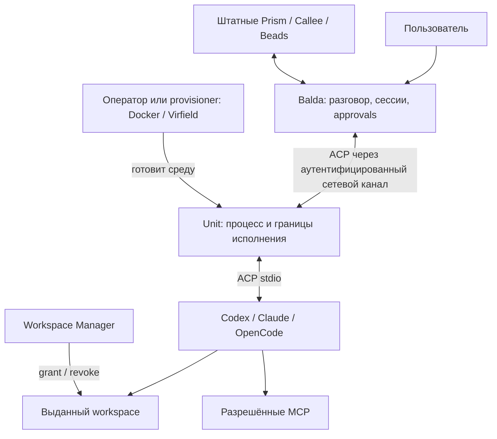

# ADR 0004: Balda Unit — remote ACP provider

- Status: Proposed
- Date: 2026-10-19
- Owners: Balda maintainers
- Decision scope: remote ACP execution, Unit inventory and admission, execution
  ownership, capacity, fencing, credentials, receipts, and cleanup
- Depends on: [ADR 0002: Backoffice-managed runtime providers](0002-backoffice-managed-runtime-providers.md)
  and [ADR 0003: YAML-first provider driver registry](0003-yaml-first-provider-driver-registry.md)
- Supersedes: none
- Approval: pending

Этот ADR расширяет ADR 0002 для удалённого исполнения; его `ProviderBinding`,
immutable revisions, full-graph validation, CAS и audit сохраняют силу. Он не
заменяет ADR 0001. Рабочее deployment-название Unit — `balda-unit`; название
продукта, форма поставки и upstream-интеграция требуют согласования с
мейнтейнером Balda.

В ходе сопровождения этого Proposed ADR согласован KISS-контракт аутентификации
Unit. Это уточнение закрывает прежние варианты enrollment, отдельной persistent
identity и credentials отдельных data channels, но не меняет общий статус ADR:
решение в целом остаётся Proposed, `Approval: pending`, а Unit ещё не реализован.

## Проверенное состояние репозитория

На момент рассмотрения 2026-10-19 Unit ещё не реализован. Этот ADR описывает
предлагаемый контракт и будущую реализацию, а не существующее поведение.

- [`SessionRecord`](../../../internal/apps/balda/state/types.go) не содержит
  Unit-specific полей. Из provider/runtime pins он хранит только существующие
  `ProviderBindingJSON` и `RuntimeSnapshotID`.
- [SQLite migration 67](../../../internal/apps/balda/state/migrations/00067_managed_providers.sql)
  и [PostgreSQL migration 32](../../../internal/apps/balda/state/postgres_migrations/00032_managed_providers.sql)
  добавляют существующий inline provider binding рядом с runtime snapshot;
  отдельного Unit execution store в текущей схеме нет.
- [`providers`](../../../internal/apps/balda/providers) остаётся единственным
  сервисом managed provider state и выдаёт secret-free inventory; его текущие
  типы и tests не содержат Unit registration или Unit authentication.
- [Backoffice client metadata](../../../internal/apps/backoffice/security/client.go)
  использует direct connection peer и игнорирует forwarded address headers,
  поскольку trusted proxy chain сейчас не настроена. Unit-specific WebSocket
  authentication и forwarding contract из этого ADR ещё отсутствуют.
- [`cmd/balda`](../../../cmd/balda) остаётся единственным executable этого
  репозитория по [`AGENTS.md`](../../../AGENTS.md). Этот ADR не утверждает
  размещение второго `cmd/*` executable.
- Текущие правила слоёв оставляют session lifecycle в `session`, storage/read
  models в `state`, runtime policy и host wiring в `execution`, а новые
  application use cases должны зависеть от небольших портов и composition-root
  adapters; см. [architecture layers](../layers.md) и
  [application sub-zones](../application-zones.md).

## 1. Предлагаемое решение

Создать небольшой исполнитель **Unit**, который запускается
в среде агента, подключается к Balda и предоставляет ей обычного ACP-провайдера.
Balda управляет агентскими сессиями и ходом работы. Unit отвечает за запуск
процесса, применение локальной политики, передачу ACP и завершение своей среды.

Реализация должна сохранять штатные контракты Balda и ACP и иметь минимальный
набор обязательных компонентов. Предлагаемые подходы к управлению процессами,
ресурсами и credentials описаны в разделе 14 с точечными ссылками на исходники.
Этот ADR описывает целевое решение, а не готовую реализацию Unit. Он расширяет
принятые ADR 0002/0003; принятие зависимостей не считается доказательством, что
их реализация уже завершена в конкретной установленной версии Balda.

Целевой пользовательский сценарий:

1. Оператор подготавливает контейнер, VM или учётную запись на хосте с агентом.
2. Администратор заранее создаёт Unit в Backoffice. Balda один раз показывает
   высокоэнтропийный bearer token вида `<public_lookup_id>.<secret>` и сохраняет
   только его криптографический digest.
3. Оператор запускает Unit с адресом интеграции Balda, локальным профилем и
   bearer token, переданным через защищённый канал. Unit открывает исходящий
   WebSocket over TLS и предъявляет token в `Authorization: Bearer`.
4. Balda аутентифицирует заранее созданный Unit, проверяет server-owned policy,
   enabled/revoked state и назначает соединению свежий generation. После этого
   Unit публикует профили и readiness в inventory. Создание Unit и подключение
   сами по себе не создают провайдера.
5. Администратор через штатный provider service создаёт managed-provider revision,
   ссылающуюся на `(unit_id, profile_id, profile_revision)`, и явно включает её
   в требуемый provider graph.
6. Сессия сохраняет только обычные `ProviderBinding` и `RuntimeSnapshotID`.
   При построении remote runtime provider driver передаёт отдельному Unit
   execution service непрозрачную неизменяемую область владельца и точную
   provider revision; admission и assignment не входят в состояние сессии.
7. Агент работает в выбранной среде; пользователь получает обычные сообщения,
   запросы разрешений и результат через Balda.

URL определяет только адрес подключения. Bearer token передаётся исключительно
в заголовке WebSocket upgrade и не помещается в URL или query.

## 2. Контекст и проблема

Balda должна работать с ACP-агентами в отдельных контейнерах, на физических
хостах и в VM через единый интерфейс провайдера. Место запуска агента не должно
менять пользовательскую модель сессии, подтверждений и получения результата.

Штатный ACP agent bridge обычно общается с клиентом через stdio. Передача этого
потока через SSH позволяет подключить подготовленный хост, но сама по себе
не решает регистрацию исполнителя в Balda, объявление доступных профилей,
управление ёмкостью и обработку перезапуска удалённой среды.

Предложенный мейнтейнером сценарий — launcher, который оператор запускает рядом
с агентом, передав URL интеграции Balda. Launcher подключается, а в административном
интерфейсе появляется исполнитель. Публикация его как провайдера отдельно следует
управляемому provider contract ADR 0002. Для такого сценария нужно определить:

- управляемое создание, аутентификацию, readiness, ротацию token и отзыв Unit;
- двусторонний ACP-транспорт и однозначную связь сессии с процессом агента;
- удалённый workspace, достижимые MCP и границы локальных полномочий;
- отмену, потерю связи, восстановление и доказанную очистку ресурсов.

Эти обязанности объединяются в Unit. Планирование работы и пользовательские
подтверждения остаются у Balda; подготовка инфраструктуры и выдача папок имеют
отдельных владельцев. Наличие протокольного подключения не считается приёмкой
модельной работы или полного workflow.

## 3. Цели и границы

### Цели

- Один центр управления разговором, агентскими сессиями и пользовательскими
  подтверждениями — Balda.
- Прямое использование штатных Codex, Claude и OpenCode ACP bridges.
- Одинаковая модель подключения для подготовленного Linux-контейнера,
  macOS-хоста и VM, с честно различающимися гарантиями изоляции.
- Запуск рядом с агентом без необходимости давать ему Docker socket,
  административный SSH-доступ или полномочия оператора.
- Явное назначение workspace, модели, MCP и политики для каждой сессии.
- Понятные отмена, потеря связи, перезапуск и очистка без повторения действий
  агента с неизвестным исходом.
- Использование проверенных подходов к процессам, ресурсам и хранению состояния
  без зависимости от чужой модели задач и форматов данных.

### За пределами обязательного Unit

- Собственный планировщик задач, workflow engine или копия Prism/Callee.
- Собственная Story/Task модель и отдельная проекция Beads.
- Собственный чат-бот, рендеринг approval forms или параллельный Human API.
- Обязательный сервис артефактов, Git cache, автоматическая публикация PR,
  миграция окружения посреди workflow и перенос произвольного состояния агента.
- Самостоятельный выбор другой модели при отказе выбранной.
- Исполнение команд на третьем хосте через общий «remote shell» агента.
- Перенос macOS workload в Linux-контейнер с обещанием нативного macOS поведения.
- Автоматическое переключение существующих сессий или удаление работающих служб
  при регистрации нового Unit.

Эти функции могут существовать отдельными расширениями, если для них появится
конкретный сценарий. Они не являются предпосылками первой ACP-сессии.

## 4. Слои и владельцы состояния



### Balda

Владеет пользовательской сессией, назначением провайдера, выбором модели,
контекстом работы, разрешениями и доставкой результата. Provider service
сохраняет единый configured/managed namespace, валидирует полный граф и управляет
неизменяемыми ревизиями по ADR 0002. Driver registry остаётся единственным
реестром типов и правил разрешения по ADR 0003.

Разделяются два состояния сессии и отдельное execution-состояние:

- `ProviderBinding` — существующее значение в состоянии сессии: root provider
  и точные ordered entries `(provider_id, source, revision_id)`.
- `RuntimeSnapshotID` — независимый pin runtime-catalog для commands, hooks,
  skills и MCP; он не хранит provider definitions или их ревизии.
- `UnitExecutionRecord` — assignment, admission, reservation, connection
  generation и cleanup receipt в отдельном Unit execution store. Эта запись не
  является частью session schema и недоступна пакету `session`.

`ProviderBinding` не получает нового ID или отдельной binding table. Wire
`binding_id` Unit обозначает execution handle конкретного процесса, а не
вторую identity provider graph. На границе построения runtime execution service
получает точную entry binding и непрозрачный `owner_scope`, идентифицирующий
неизменяемое время жизни разговора. Он не читает и не изменяет `SessionRecord`.
Пакет `session` не знает о Unit, connection generation, admission или binding
lifecycle.

### Штатные Prism, Callee и Beads

Сохраняют свои контракты ролей, фаз и задач. Unit предоставляет исполнителя
агентской сессии и не запускает Callee workflow как обязательную оболочку вокруг
каждого запроса. Интеграцию этих компонентов с удалённым провайдером требуется
проверить отдельно: наличие рабочего ACP-транспорта её не доказывает.

### Unit

Владеет локальным запуском ACP-процесса, рабочим каталогом, процессной группой,
ограничениями исполнения, транспортным соединением и техническим журналом
binding. В журнале нет собственной модели бизнес-задач или очереди Story.

### Unit execution service

Прикладной execution-контур Balda владеет inventory Unit, assignments,
admission, согласованием ёмкости, connection-generation fencing и cleanup
receipts. Он хранит их отдельно от session state и получает от composition
boundary только непрозрачный неизменяемый `owner_scope`, exact provider revision
и execution request. Сервис не читает и не изменяет session records. Provider
driver является его клиентом; session lifecycle не импортирует Unit-контракты
и не координирует их переходы.

### Workspace Manager

Владеет выдачей конкретного каталога конкретному получателю, RO/RW, сроком
доступа и фактическим отзывом. Discovery корня не означает доступ к его файлам.
Unit использует выданный grant и не создаёт второй независимый workspace lease.
Его собственный срок binding может только дополнительно ограничивать запуск.

### SSH Manager и provisioner

SSH Manager остаётся средством подготовки и проверки SSH-доступа к существующим
хостам. Для постоянно подключённого Unit SSH не требуется как канал ACP.
Docker/Virfield provisioner, если используется, подготавливает среду и может
установить или запустить Unit. Его административные полномочия находятся за
пределами процесса агента.

### Граница ответственности

Один ресурс имеет одного владельца: сессию назначает Balda, процесс завершает
Unit, workspace отзывает Workspace Manager, VM освобождает её provisioner.
Нижний слой сообщает фактическое состояние; верхний не подменяет отсутствие
подтверждения оптимистичным `success`.

## 5. Где выполняются агенты и субагенты

Unit размещается в той же среде исполнения, где запускается его ACP-агент:

- В подготовленном Linux-контейнере Unit и agent bridge работают внутри этого
  контейнера. Исходники доступны через разрешённый mount или подготовленный
  локальный workspace.
- На macOS Unit запускает agent bridge под принятой Seatbelt-политикой.
- В macOS VM Unit работает внутри гостевой ОС; Virfield управляет самой VM.

В первой реализации один binding соответствует одному ACP-процессу и одной
ACP-сессии. Разные сессии получают отдельные процессы и каталоги состояния.
При нескольких агентах Unit объявляет только проверенную оператором ёмкость;
без отдельной приёмки значение равно одному одновременному binding.

Субагент, которого Balda назначила Unit-провайдеру, выполняется на этом Unit.
Вложенный процесс или внутренний субагент самого Codex/Claude остаётся в той же
среде и наследует её ограничения. Запуск на другом Unit требует отдельного
назначения Balda; текст prompt или само слово «субагент» не меняют размещение.

Модель может обслуживаться внешним API, но файловые операции, shell-команды и
локальные инструменты исполняются в среде агента. Сетевые MCP выполняют свою
работу на стороне соответствующего MCP-сервиса.

## 6. Подключение и регистрация Unit

Это **новый совместный контракт Balda и Unit**, а не существующий API Balda.
Конкретные URL paths, schema, названия provider types и номера версий wire
protocol должны быть согласованы до реализации. Ниже определены требования
к поведению, а не объявлен готовый endpoint.

### Создание и первичное подключение

1. Администратор создаёт Unit в Backoffice до запуска Unit. Операция создаёт
   стабильный `unit_id`, server-owned policy и состояние `enabled`.
2. В приватном `no-store` ответе Balda ровно один раз показывает
   высокоэнтропийный bearer token формата `<public_lookup_id>.<secret>`.
   `public_lookup_id` нужен только для поиска записи и не является
   аутентификатором. Balda сохраняет public lookup ID, криптографический digest
   token secret и необходимую служебную metadata, но не plaintext token или
   secret.
3. Оператор передаёт Unit integration URL и token через защищённый ввод,
   secret file или secret mount. Token не передаётся аргументом CLI и не
   наследуется запускаемым agent process.
4. Unit открывает исходящий WebSocket over TLS и посылает
   `Authorization: Bearer <public_lookup_id>.<secret>` в HTTP upgrade. Token не
   помещается в URL, query, cookie, WebSocket subprotocol или первое сообщение.
5. До upgrade Balda находит заранее созданный Unit по public lookup ID,
   криптографически проверяет secret по сохранённому digest, проверяет, что Unit
   enabled и не revoked, и применяет server-owned policy. Присланные клиентом
   или proxy forwarded identity headers не участвуют в identity или policy.
6. Для принятого соединения Balda атомарно назначает свежий монотонный
   connection generation. Новый принятый generation fence-ит прежнее соединение
   и все его поздние сообщения. Только после этого Unit может объявить профили,
   readiness и принимать bindings.

Создание Unit, подключение и публикация inventory не изменяют provider
definitions, provider graph или `provider_state_version`. Token является
единственным credential Unit для WebSocket-аутентификации: отдельные enrollment
credentials, asymmetric key pairs, challenge-response, message signatures и
вторая persistent identity credential не используются.

Rotation и revocation — явные операции Backoffice. Rotation генерирует новый
token, показывает его один раз, атомарно заменяет digest и fence-ит текущее
соединение; прежний token больше не принимается. Revocation fence-ит соединение,
запрещает новые подключения и admissions и не отменяется reconnect. Возврат в
эксплуатацию требует явной принятой административной операции; он не происходит
из heartbeat или объявления Unit.

### Граница TLS и reverse proxy

Публичный TLS завершается на доверенном reverse proxy. Proxy обязан передавать
`Authorization` в Balda без удаления или подмены. Участок proxy → Balda проходит
по loopback, защищённой сети или отдельно защищённому transport. Balda игнорирует
forwarded identity headers, включая заголовки, которые заявляют Unit, user или
роль: bearer token и server-owned state являются единственным основанием
аутентификации и авторизации Unit.

Reverse proxy входит в trust boundary этого решения, потому что видит bearer
token после TLS termination. Если proxy находится вне доверенной границы и
участок до Balda отдельно не защищён, этот ADR не заявляет end-to-end
confidentiality. Такой deployment требует другого принятого transport или
дополнительной защиты вне этого решения.

### Объявление возможностей

Unit сообщает идентификаторы локальных профилей, версии Unit и agent bridge,
ОС/архитектуру, ограничения параллельности, доступные sandbox profiles,
поддерживаемые версии ACP и ограничения resume. Заявленная возможность должна
подтверждаться проверкой установленного профиля и ACP handshake.

Unit не принимает из регистрации произвольный shell command, image, host path
или Docker flags. Сетевой запрос ссылается на локально настроенный профиль.
При изменении бинарника, image или политики меняется revision профиля;
действующие bindings сохраняют назначенную revision.

### Inventory и managed providers

`UnitRegistration` содержит стабильный `unit_id`, public lookup ID, lifecycle
state, текущий connection generation, состояние подключения, readiness,
доступную ёмкость и descriptors локальных профилей. Digest и token не входят в
inventory projection. Это inventory исполнителей; оно не является
`ProviderDefinition`, runtime-catalog contribution или обходным каналом
обновления `runtime.providers`.

Managed provider создаётся отдельным явным действием администратора через
существующий provider service. Его immutable revision содержит публичную typed
`ProviderDefinition` с `(unit_id, profile_id, profile_revision)`, canonical driver
type и `ContractVersion`; protected values сохраняются по ADR 0002. Изменение
inventory, reconnect, heartbeat или объявление нового профиля не создают и не
активируют такую revision и не заменяют pins действующих сессий.

Для каждого проверенного descriptor сохраняются tuple
`(unit_id, profile_id, profile_revision)`, canonical descriptor bytes и их
криптографический digest. Canonicalization включает все поля, влияющие на
исполняемый bridge, image, policy, capabilities и limits; порядок map-полей и
отсутствующие значения нормализуются версией schema до вычисления digest.
Повторное объявление той же tuple допустимо только с тем же digest. Иное
содержимое считается identity conflict: новый descriptor не заменяет старый,
профиль помещается в quarantine, а текущее соединение fence-ится и не получает
новые admissions до явного исправления с новой `profile_revision`.

Descriptors неизменяемы и сохраняются, пока на них ссылаются retained provider
revisions. Новый inventory head не перезаписывает их. Descriptor сам по себе не
доказывает retention исполняемых bytes: provider service вычисляет
reproducibility по правилам ADR 0002 и не выдаёт внешние изменяемые inputs за
точный artifact pin.

Для этого нужен встроенный remote ACP driver в registry ADR 0003. Рабочее имя
`unit_acp` не является готовым API. Descriptor задаёт typed config, passive
validation, normalization, environment policy и immutable identity fields.
Для первого инкремента canonical type, `unit_id`, `profile_id` и
`profile_revision` считаются immutable identity: их смена требует нового
provider ID. Более гибкие изменения допускаются только отдельным уточнением
контракта driver. Unit не регистрирует исполняемый driver-код. Managed
`generic_acp`, произвольный `cmd` и command overrides не используются как обход
ограничений ADR 0002.

Каждая managed mutation выполняется одним путём:

1. Provider service читает согласованный `ReadProviderState` и
   `provider_state_version`.
2. Проверяет complete candidate graph, namespace collisions, references,
   immutable identity и driver contract. Ссылка на profile revision проверяется
   по сохранённому immutable descriptor; validation не запускает agent или probe.
3. Одной транзакцией записывает revision/lifecycle state, audit и увеличенный
   `provider_state_version` через CAS того же прочитанного state version.
4. При конфликте не оставляет частичных revision, graph edits или audit и не
   повторяет пользовательское решение как безусловную запись.

Глобальный `provider_state_version` остаётся единственным optimistic token для
provider mutations; Unit не добавляет собственный activation catalog, provider
cache или публикацию определений через heartbeat. Unit inventory может меняться
независимо, но runtime-readiness не переписывает валидную definition. Offline
исполнитель делает исполнение недоступным, а не изменяет bound graph.

Админка показывает отдельно inventory Units и Administration → Providers.
Подтверждённый ready Unit становится доступен агентской сессии только через
явно созданную revision и обычный provider graph. Страницы, чтение inventory,
managed mutations и startup compilation остаются пассивными: без initialize,
model discovery, authentication или model prompt. Приёмка readiness — отдельная
операция; UI использует уже полученные receipts.

### Состояния доступности

Административный lifecycle отделён от наблюдаемого состояния соединения.
`enabled` разрешает аутентификацию при действующем token и server-owned policy;
`revoked` запрещает подключения и новые admissions. Подключённый enabled Unit
может быть `ready`, `busy` или `draining`; без принятого свежего connection
generation он `offline`. Создание записи не даёт промежуточному `pending`
enrollment полномочий, потому что enrollment protocol отсутствует.

Регистрация, открытый порт, успешный `initialize`, успешная модельная работа и
полный lifecycle — разные уровни доказательства. UI не должен сводить их к
одному постоянному флагу «всё работает».

## 7. Сетевой транспорт и ACP

### Выбор для первой реализации

Предлагается одно исходящее WebSocket over TLS соединение Unit → Balda. Оно
позволяет запускать Unit за NAT без входящего порта к агенту. Balda остаётся
логическим ACP client, агент — ACP server, независимо от того, какая сторона
установила TCP.

Аутентифицированное соединение несёт control envelopes для inventory,
readiness, `open_binding`, lookup admission, идемпотентных
`close_binding`/`abort_binding`, drain и cleanup receipts, а также ACP frames
активных bindings. Envelope содержит назначенный Balda connection generation и
точный `binding_id`; ACP JSON-RPC внутри binding сохраняется без изменения.
Отдельный WebSocket и отдельный credential на каждый binding не создаются.

Reverse WebSocket — предлагаемый транспортный профиль интеграции. Он не
объявляется стандартным ACP web transport или готовой возможностью SDK.
Совместимость и окончательный wire profile проверяются в первом прототипе с
мейнтейнером. Если upstream выбирает совместимый Streamable HTTP, меняется
transport adapter при сохранении границ и lifecycle этого ADR.

### Аутентификация и connection fencing

WebSocket upgrade аутентифицируется ровно bearer token из раздела 6. Balda не
принимает token из query, cookie, subprotocol, body или forwarded identity
header. Проверка token, enabled/revoked state и server-owned policy происходит
до `101 Switching Protocols`; failure не создаёт connection generation и не
открывает доступ к inventory или ACP.

Принятому socket Balda атомарно назначает свежий connection generation и
связывает его с `unit_id`. Всякий control или ACP envelope обязан содержать этот
generation. Balda и Unit отвергают сообщения старого generation; принятие нового
соединения fence-ит прежнее и запускает reconciliation его admissions и
bindings. Generation не является credential, provider revision или ACP session
ID и не позволяет подключиться без token.

При `open_binding` execution service проверяет exact owner, provider/profile
revision, admission и актуальный connection generation до передачи команды
Unit. Unit journal делает open идемпотентным и связывает процесс с тем же scope.
Поэтому Unit-wide bearer не даёт произвольному frame право присоединиться к
чужому binding: Balda формирует assignments, а обе стороны проверяют точный
scope и generation. Отдельных attach handshakes, nonce, TTL, channel credential,
его hash/status или перевыпуска после потери ACK нет.

Rotation, revocation, policy denial, heartbeat loss или принятие нового
соединения закрывают либо fence-ят прежний socket. Поздние frames не могут
открыть процесс, подтвердить permission, принять cleanup receipt или продолжить
ACP старого generation.

### Почему одного JSON endpoint недостаточно

ACP использует двусторонний JSON-RPC. Через канал должны проходить запросы,
ответы и notifications в обоих направлениях, включая прогресс, permission
requests и отмену. Спецификация разрешает custom transport, сохраняющий формат
и lifecycle. Streamable HTTP в текущей спецификации отмечен как draft; Python
SDK имеет экспериментальные HTTP/WebSocket adapters. Это исходная техническая
возможность, а не доказательство совместимости с Go runtime Balda.

Unit соединяет сетевой поток с `stdin/stdout` штатного agent bridge. `stderr`
отделён от ACP и используется для ограниченных диагностических логов. Unit не
генерирует вместо агента модельные ответы и не переводит его события в
отдельные workflow events или промежуточные бизнес-сущности.

JSON-RPC IDs, notifications, ошибки и согласованные расширения сохраняются.
Версия ACP и capabilities согласуются через `initialize`. Неизвестная версия
интеграции, несовместимая обязательная capability или недостижимый transport
приводят к явному отказу до prompt. Нельзя молча сменить агента, модель или
перейти на другой транспорт с более широкими правами.

### Ограничения потока

Транспорт должен иметь ограниченные размеры сообщений и очередей, backpressure,
таймауты записи и корректное закрытие. Переполнение приводит к видимой ошибке
и завершению binding; потеря сообщений прогресса или permission request ради
продолжения работы недопустима. Лимиты задаются версией профиля и проверяются
до активации binding. Control envelopes имеют отдельную ограниченную очередь и
приоритет над ACP output; Unit также применяет локальный heartbeat timeout и
cleanup policy, поэтому зависший ACP producer не может бесконечно удерживать
процесс после утраты управляющего соединения. Полностью недоступная сеть всё
равно приводит к local timeout и reconciliation, а не к обещанию мгновенной
удалённой отмены.

## 8. Создание и жизненный цикл binding

### Граница session и execution

Session contract остаётся ровно контрактом ADR 0002: `SessionRecord` хранит
`ProviderBinding` и независимый `RuntimeSnapshotID`. Он не содержит
`UnitAssignment`, Unit identity, token, connection generation, admission,
cleanup receipt или placement policy Unit. Пакеты session lifecycle не
импортируют Unit execution contracts и не выполняют переходы binding.

При построении runtime точная remote-provider revision из `ProviderBinding`
попадает в remote driver. Composition boundary также передаёт драйверу
`owner_scope` — непрозрачный стабильный идентификатор конкретного времени жизни
разговора. Unit execution service не знает `SessionRecord`, transport routing
или способ образования scope. Reset и новый conversational lifetime получают
новый scope; поздние ACK, frames и receipts прежнего scope не могут изменить
новое исполнение.

Remote driver обращается к `UnitExecutionService`. Сервис и отдельный
`UnitExecutionStore` владеют:

```text
owner_scope + selected_provider_id + provider_revision_id
unit_id + profile_id + profile_revision + descriptor_digest
connection_generation
binding_id + admission_id + canonical_request_digest
state + capacity_reservation + acp_session_id + cleanup_receipts
```

Запись ссылается на retained provider revision, но не дублирует и не изменяет
provider graph. Для ordinary/reset, scheduled/webhook, pool,
goal/session-memory runtimes действует один driver/execution path. Consumer не
выбирает Unit из live inventory в обход bound graph.

Первая restore policy — `pinned_unit_profile`. Она следует из immutable remote
provider revision, содержащей `unit_id`, `profile_id` и `profile_revision`;
отдельного Unit pin в сессии нет. Restore той же `ProviderBinding` не выбирает
другой Unit или новую revision. Dynamic rescheduling под той же revision не
поддерживается.

### Авторитетная ёмкость и durable admission

Readiness и свободные slots в Balda являются только advisory данными для выбора
и UI. Durable admission journal Unit является авторитетным источником и
атомарно резервирует глобальную ёмкость Unit и профильный лимит до создания
процесса. Он охватывает все процессы Unit независимо от числа session rows,
экземпляров Balda и reconnect.

Каждый `open_binding` содержит exact execution scope, глобальный лимит Unit и
лимит профиля. До создания процесса Unit одной локальной транзакцией:

1. проверяет generation, descriptor digest, cancellation fence и отсутствие
   другого payload для admission ID;
2. считает все active и uncertain reservations Unit и выбранного профиля;
3. создаёт уникальную reservation и `opening` либо возвращает
   `capacity_exhausted` без запуска процесса.

Уникальность admission/reservation и лимит проверяются под одним локальным
lock/transaction. Повтор exact request возвращает прежнюю reservation; тот же
admission с другим digest конфликтует. Reservation освобождается только после
durable terminal state и доказанной cleanup; `uncertain` удерживает slot.
Поэтому две конкурентные сессии не занимают один последний slot, даже если обе
увидели одинаковое advisory readiness.

Unit execution service владеет capacity protocol и может хранить проекцию для
reconciliation, но не объявляет slot занятым или свободным вопреки Unit journal.
Если Unit недоступен, новый admission не считается зарезервированным.

### Порядок открытия

1. Runtime восстанавливает exact bound graph по ADR 0002/0003, выбирает remote
   leaf в сохранённом порядке и передаёт driver непрозрачный `owner_scope`.
2. Unit execution service атомарно создаёт
   `UnitExecutionRecord(state=opening)` с `binding_id` и `admission_id` до
   remote side effect. Условие включает owner scope, provider/profile revisions,
   текущий connection generation и canonical request digest.
3. После commit сервис отправляет `open_binding` по аутентифицированному
   соединению текущего generation. Unit атомарно резервирует capacity, проверяет grants,
   MCP/network и sandbox, затем создаёт процесс. Повтор open идемпотентен; иной
   payload конфликтует.
4. Driver и agent bridge по тому же fenced соединению выполняют `initialize` и
   создают ACP-сессию, не отправляя prompt. ACP session ID сначала durable
   фиксируется в Unit journal.
5. Execution service условно переводит `opening → active`. Условие проверяет
   owner scope, admission, revisions, digest, connection generation
   и отсутствие конкурирующего cancel.
6. Только после commit `active` remote driver отправляет первый prompt.

Если commit шага 2 не состоялся, Unit не получает open. После remote side effect
execution store сохраняет admission ID для lookup/abort. Потеря ACK шага 4
восстанавливается из Unit journal; неполные доказательства дают `uncertain` без
переиспользования slot. Если active transition проиграл cancel, prompt не
отправляется, а admission закрывается через control-plane abort.

### Точное восстановление и новый lifetime

Session restore загружает только `ProviderBinding` и `RuntimeSnapshotID`.
Runtime factory строит exact provider graph, а driver передаёт execution service
тот же opaque owner scope. Execution service сам reconciles принадлежащие scope
records. Session layer не загружает и не интерпретирует assignments.

Retained revisions работают после disable/tombstone по ADR 0002, но live policy
сохраняется: revoked Unit, недоступная profile revision, descriptor quarantine
или неподтверждённая process identity запрещают исполнение.

Generation — fencing epoch Unit connection, а не provider revision. Он не
разрешает frame старого socket или предполагаемый resume. После доказанной
остановки execution service может создать новый assignment к той же exact
provider/profile revision и owner scope. ACP context переносится только при
принятой resume capability и reconciliation; prompt с неизвестным исходом не
повторяется.

Bounded fresh-session fallback ADR 0002 создаёт новый conversational lifetime,
новые pins и новый opaque owner scope. Старые records остаются только для
reconciliation/cleanup; их ACK, frame и receipt не проходят условия нового
scope. Старые `uncertain` reservations удерживаются до terminal cleanup.

### Состояния binding

В execution store: `opening → active → closing → closed`. Локальные
`reserved`, `preparing` и `starting` в Unit journal детализируют `opening`, но
не разрешают prompt до `active`. Ошибки дают `failed`; неизвестный исход или
недоказанная остановка дают `uncertain` и удерживают capacity.

Binding закрывает владелец runtime при завершении owner scope, отмене, отзыве
или отказе. Session package не знает Unit command или state machine:
runtime/provider teardown вызывает общий driver close.

### Отмена и закрытие

ACP cancel и control operations идут через разные bounded queues одного
аутентифицированного WebSocket. При blocked ACP producer, timeout, отзыве или
teardown driver вызывает операции execution service:

- `close_binding` прекращает prompt, ограниченно ждёт и завершает process tree;
- `abort_binding` немедленно запускает ограниченную принудительную остановку.

Операции содержат idempotency command ID, owner scope и exact
Unit/generation/binding/admission scope. Execution store и Unit journal durable
сохраняют fence. Повтор возвращает прежний результат; иной payload конфликтует.
Abort неизвестного admission создаёт fence для позднего open.

После reconnect connection lifecycle выполняет lookup/cleanup прежнего
generation, не разрешая старым frames продолжить binding. Handler не ждёт ACP
stdout или ACP producer lock; при недоступной сети локальный Unit timeout
запускает cleanup, а Balda сохраняет `uncertain` до receipt и reconciliation.

Unit возвращает durable cleanup receipt с owner scope, exact execution scope,
operation ID, process/container identity, stopped state и остаточными
обязательствами. Execution service принимает его условным переходом exact
record; receipt другого owner scope не подходит. Он не меняет provider revision,
`ProviderBinding`, workspace lease или VM state другого владельца.
Недоказанная остановка даёт `uncertain` и не освобождает capacity.

## 9. Разрывы связи, часы и восстановление

При утрате heartbeat Balda прекращает новые назначения. Unit перестаёт принимать
новые bindings и незавершённые permission responses от старого соединения.
В первой версии потеря Unit WebSocket инициирует локальную отмену и ограниченную
остановку связанных процессов; прозрачное продолжение активного prompt не
обещается.

Запрос, записанный в соединение без полученного ответа, может иметь неизвестный
исход. Его нельзя автоматически отправлять новому агенту или воспроизводить
после reconnect. Транспортный reconnect и resume модельной сессии — разные
операции. Resume разрешён только для согласованной capability конкретного
агента после reconciliation и привязки к прежней области доступа. Pins и
правила fresh-session fallback определены разделом 8 и ADR 0002; подбор другого
Unit на restore в этот контракт не входит.

После перезапуска Unit не считает старые PID доказательством живого процесса.
Нужны проверяемая process/container identity и connection generation; оставшиеся ресурсы
сначала обнаруживаются и останавливаются либо изолируются в `uncertain`.
Повторный запуск процесса не обозначается восстановлением прежнего исполнения.
После рестарта Balda существующие bindings также требуют reconciliation.

Упаковка Unit должна предусматривать остановку потомков при смерти самого Unit.
В контейнере это проверяется вместе с lifecycle контейнера; на нативном хосте —
с принятой политикой системного supervisor и последующим reconciliation.
Одна process group без такого механизма не гарантирует cleanup после падения
родителя. Если bounded остановку обеспечить нельзя, профиль не объявляется
готовым для автономной работы. Проверяется именно аварийная смерть процесса,
а не только обработанный сигнал корректного завершения.

Heartbeat expiry и локальные интервалы измеряются монотонными часами своей
стороны. На reconnect сроки не продлеваются неявно. Срок workspace определяет
его владелец. Для внешних абсолютных сроков требуется определённая политика
рассинхронизации; timestamps разных машин не сравниваются как порядок событий.
Порядок control messages задают generation/sequence, timestamps остаются аудитом.
Конкретные heartbeat interval и timeout фиксируются в контрактном прототипе.

## 10. Workspace и файловые операции

Для каждого binding должны быть явно согласованы grant, получатель, режим
доступа и путь в среде Unit. Типовые варианты — доступ к исходным файлам через
выданный SMB grant либо заранее подготовленный локальный checkout. Это разные
семантики; Unit не заменяет одну другой скрытым копированием проекта.

Один изменяемый checkout не выдаётся нескольким исполнителям без явной политики
координации. Для параллельных изменений назначаются разные worktrees/workspaces;
их подготовка относится к владельцу рабочего процесса или workspace.

В ACP передаётся абсолютный `cwd`, существующий в среде агента. Balda adapter
должен различать локальный и удалённый `cwd`: локальная проверка `os.Stat`
не должна требовать существования удалённого пути внутри контейнера Balda.
Вместо неё удалённый путь проверяется Unit в пределах выданного grant.
Один `cd` в launcher не заменяет корректный `session/new.cwd`.

Разрешение путей, дополнительные каталоги, symlinks и mount boundaries проверяет
принимающая среда. Текст задачи и репозиторий не могут расширить grant. Изменение
прав или истечение срока прекращает соответствующий доступ, включая открытые
дескрипторы в пределах гарантий выбранного backend.

ACP client callbacks требуют отдельной проверки. Если агент запрашивает
файловые или terminal операции у клиента, такие операции должны выполняться
в среде назначенного Unit и в той же песочнице. Для неподдержанного callback
объявляется отсутствие capability либо возвращается явный отказ. Выполнение
на хосте Balda в качестве fallback запрещено. Transport adapter не должен
размывать место исполнения за счёт стандартных клиентских обработчиков.

## 11. MCP, инструменты и credentials

MCP-конфигурация формируется Balda для конкретного назначения. Профиль Unit
ограничивает допустимые подключения и возможности. Agent-side MCP endpoint
должен быть достижим именно из среды агента: `localhost` контейнера Balda или
случайно открытый локальный порт не являются рабочим удалённым адресом.

Допустимые варианты — внутренний service address общей Docker-сети либо
аутентифицированный scoped proxy. Контракт proxy фиксирует binding, срок и
разрешённые операции. Произвольный проброс localhost и широкое отключение
проверок hostname не входят в решение. Stdio MCP запускается в среде Unit
из разрешённого профиля; команда stdio MCP не исполняется на Balda по ошибке.

Инструменты выдачи доступа, регистрации хостов и управления инфраструктурой
остаются у управляющей стороны, если отдельно не разрешена ограниченная роль.
Запуск удалённого агента не означает передачу ему токенов SSH Manager,
Workspace Manager, Docker/Virfield администратора или административного API Balda.

Нужно различать:

- bearer token Unit для аутентификации WebSocket Balda;
- credentials модельного провайдера внутри среды агента;
- scoped MCP credentials конкретного binding;
- credentials инфраструктуры и файловых shares у их владельцев.

Для MVP модельная авторизация подготавливается оператором локально в изолированном
agent home или через существующий принятый credential helper. Unit сообщает
`authentication_required`, если её нет. Сетевой ACP transport не должен
незаметно устанавливать, копировать или менять личные credentials оператора.
Если используется credential helper, его контракт должен сохранять exclusive
lease и cleanup fencing. Подход к такой выдаче описан в разделе 14.4.

Bearer token Unit не входит в provider definition, inventory, agent environment,
URL, query или логи. Persistent state содержит public lookup ID и только digest
из secret material; plaintext доступен один раз при создании или rotation.
Token Unit и модельная авторизация имеют отдельные процедуры. Отзыв token Unit
не объявляется доказательством отзыва сессии у внешнего модельного провайдера.

## 12. Песочница и доверие

Unit работает с операторским профилем запуска. Профиль определяет установленный
executable, допустимые args, sandbox, grant roots, сеть и ресурсы. Prompt не
может добавить shell launcher, privileged flags, host mounts, socket или sudo.
Изменение профиля создаёт новую revision и требует обычной операторской процедуры.

На Linux подготовленный контейнер ограничивает mounts, capabilities, UID,
ресурсы и сеть. Bubblewrap может использоваться для дополнительной локальной
изоляции там, где она поддержана и проверена. Его наличие внутри контейнера
не предполагается автоматически и не является условием всех Docker deployments.
При обязательной, но недоступной политике запуск прекращается.

На macOS агент и потомки запускаются под принятой Seatbelt-политикой. VM даёт
отдельную гостевую среду; контейнеры разделяют ядро с их Linux host. Эти режимы
не маркируются одинаковым уровнем изоляции. Unit не получает право управлять
гипервизором только потому, что работает в гостевой системе.

Защита исходит из доверенного оператора Balda и подтверждённых Units, а не из
публичного multi-tenant сервиса. При нескольких пользователях Balda обязана
сформировать проверенную область назначения; присланные моделью chat/session
IDs не считаются проверенной identity. Unit может читать доступные агенту
данные и относится к доверенной части выбранной среды исполнения.

Сетевой trust boundary включает TLS-terminating reverse proxy и защищённый
участок proxy → Balda из раздела 6. Bearer token является reusable secret, поэтому
доступ proxy к нему равен возможности аутентифицировать Unit до rotation или
revocation. Forwarded identity headers не уменьшают этот риск и игнорируются.
При внешнем недоверенном proxy этот ADR не обещает end-to-end confidentiality.

Readiness sandbox подтверждается реальными пробами: разрешённые операции,
RO-запрет, чтение/запись вне grant, symlink escape, дочерний процесс и поведение
при отзыве. Успешный запуск CLI, установленный флаг или `cwd` такой проверки
не заменяют.

## 13. Подтверждения и пользовательский интерфейс

Владельцем пользовательского разрешения остаётся Balda. Unit передаёт исходный
ACP permission request и возвращает решение штатному агенту, сохраняя IDs,
варианты и смысл ответа. Он не создаёт вторую форму, не интерпретирует `1`
самостоятельно и не превращает отказ пользователя в транспортную ошибку.

Сопоставление учитывает connection generation Unit, binding, ACP-сессию и request ID.
Повторно доставленный запрос не создаёт второй независимый approval. Старый
ответ не подтверждает запрос нового процесса или другой сессии. При отсутствии
контекста, timeout, отмене или отзыве Unit не выдаёт разрешение по умолчанию.

Ошибки readiness, authentication, network, workspace и user denial различаются
и сохраняют свой источник. UI показывает выбранные Unit, среду, профиль,
модель и workspace. Нельзя сообщить о работе на удалённом хосте, если Balda
фактически выбрала локальный provider. Переход на другой Unit после отказа
требует явного нового назначения в пределах политики Balda.

Инфраструктурные подтверждения выдачи папки или подключения Unit сохраняют
собственный смысл. Они не повторяются как дополнительное generic approval
для каждого обычного ACP-сообщения.

## 14. Подходы к реализации и примеры исходного кода

Ниже приведены подходы, которые предлагается заимствовать. Ссылки ведут на
конкретные функции в зафиксированной ревизии `13c29ac6`; это примеры реализации,
а не обязательная runtime-зависимость Unit. Переносится описанный механизм с
его проверками и тестами. Форматы записей, идентификаторы ресурсов и API Unit
определяются его собственными контрактами.

При review 2026-10-19 публичные GitHub URL этой ревизии возвращали HTTP 404.
Ссылки сохранены как provenance исходного предложения, но не считаются
проверенным implementation evidence. До approval их нужно сделать доступными
либо заменить доступными immutable ссылками и повторно проверить заявленные
механизмы.

### 14.1. Остановка процесса с доказательством результата

Каждый агент запускается в управляемой процессной группе. При закрытии binding
supervisor завершает группу и отдельно проверяет, что исполняемых участников
не осталось. Успешная отправка сигнала не считается доказательством остановки.
Ошибка наблюдения сохраняет неопределённость и запрещает повторную выдачу
эксклюзивных ресурсов.

Примеры: [`stopProcessGroup`](https://github.com/mallexxx/execution-broker/blob/13c29ac6ccb3ec59cb7fa4d824bdfb350bf540e6/internal/runner/process_group.go#L22) и [`liveProcessGroup`](https://github.com/mallexxx/execution-broker/blob/13c29ac6ccb3ec59cb7fa4d824bdfb350bf540e6/internal/runner/process_group.go#L62). В них есть ограниченное ожидание,
наблюдение через `/proc` на Linux и process status на macOS. Отдельно учитывается
случай XNU, когда zombie-only группа даёт `EPERM`: безопасное завершение
подтверждается независимым наблюдением, а не игнорированием ошибки.

Для Unit нужно отделить этот механизм от состояния workflow, связать его с
process identity конкретного binding и испытать аварийное завершение supervisor.
Процессы, вышедшие из своей группы, требуют OS-level containment и отдельной
приёмки. Один helper остановки группы не заменяет весь контракт изоляции.

### 14.2. Независимая очистка только собственных ресурсов

Ресурс получает стабильную identity и метаданные владельца: Unit, connection generation,
binding и профиль. Перед удалением проверяется фактическая принадлежность.
Очистка контейнера и связанного volume идемпотентна; потеря процесса между этими
действиями не должна делать остатки необнаружимыми.

Примеры: [`Reap`](https://github.com/mallexxx/execution-broker/blob/13c29ac6ccb3ec59cb7fa4d824bdfb350bf540e6/internal/worker/reaper.go#L17) и [`removeVolume`](https://github.com/mallexxx/execution-broker/blob/13c29ac6ccb3ec59cb7fa4d824bdfb350bf540e6/internal/worker/worker.go#L386). Первый механизм независимо
находит просроченные контейнеры и оставшиеся volumes, второй перед удалением
сверяет имя и ownership labels. Самостоятельный обход volumes закрывает падение
между удалением контейнера и удалением его данных.

В Unit/provisioner заимствуется принцип независимого reaper и точной ownership
проверки. Имена labels, сроки grace и политика хранения задаются для новой
среды отдельно. Нельзя удалять чужой контейнер по совпавшему префиксу. Reaper
инфраструктуры остаётся вне полномочий агентского процесса.

### 14.3. Идемпотентное получение и освобождение VM

Перед созданием внешнего ресурса сохраняются параметры операции и стабильный
admission ID. При потере ответа повторяется та же операция с тем же ключом:
она должна вернуть тот же ресурс, а не выделить второй. Отмена неопределённого
создания сначала восстанавливает его исход, затем освобождает найденный lease.

Примеры: [`Provision`](https://github.com/mallexxx/execution-broker/blob/13c29ac6ccb3ec59cb7fa4d824bdfb350bf540e6/internal/transport/virfield.go#L120) и [`Release`](https://github.com/mallexxx/execution-broker/blob/13c29ac6ccb3ec59cb7fa4d824bdfb350bf540e6/internal/transport/virfield.go#L468). Они показывают
выделение VM по стабильному ключу и восстановление результата acquire перед
release, если подтверждение создания не было сохранено.

Этот подход нужен опциональному VM provisioner. Unit получает готовую среду и
не наследует административные credentials или существующий SSH RPC-протокол.
Его ACP-соединение и lifecycle binding остаются самостоятельными контрактами.

### 14.4. Эксклюзивная выдача модельной identity

Если аккаунт или изменяемый auth cache требуют эксклюзивного использования,
credential helper связывает выдачу с конкретным binding, профилем и сроком.
Повтор идентичной выдачи возвращает тот же scope. Другому владельцу identity
не выдаётся, пока прежний владелец не освобождён по проверенной процедуре.

Примеры: [`Issue`](https://github.com/mallexxx/execution-broker/blob/13c29ac6ccb3ec59cb7fa4d824bdfb350bf540e6/internal/credential/vault.go#L227) и [`Release`](https://github.com/mallexxx/execution-broker/blob/13c29ac6ccb3ec59cb7fa4d824bdfb350bf540e6/internal/credential/vault.go#L315). В выдаче проверяется
совпадение полного lease scope. Повторный release прежнего владельца не должен
освобождать identity, уже назначенную новому. Истечение времени само по себе
не доказывает, что прежний процесс перестал использовать или обновлять токен.

В Unit это адаптируется к binding/generation. Credential helper проверяет
предпосылки освобождения, а supervisor/provisioner предоставляет доказательство
остановки. Локальный checkpoint не объявляется отзывом авторизации у внешнего
провайдера. Для MVP допускается отдельно подготовленный оператором agent home;
полный сервис выдачи не становится обязательным для любого профиля.

### 14.5. Атомарное сохранение закрытого состояния

Изменяемое приватное состояние сериализуется под межпроцессной блокировкой.
Новая запись сохраняется во временный файл, синхронизируется, атомарно
заменяет прежний файл, затем синхронизируется каталог. Это позволяет пережить
падение между записью данных и публикацией нового состояния.

Пример: [`transaction`](https://github.com/mallexxx/execution-broker/blob/13c29ac6ccb3ec59cb7fa4d824bdfb350bf540e6/internal/credential/vault.go#L74). Для credential records там
используется authenticated encryption с областью identity/provider и свежим
nonce. Заимствуется сочетание блокировки, проверки целостности и durable replace;
привязки к конкретному формату или поколению записи не копируются автоматически.

Unit хранит небольшой журнал connection generations, admissions, bindings и cleanup. Баланс
между SQLite-транзакциями и отдельными приватными файлами определяется типом
данных. Секреты не смешиваются с обычным диагностическим журналом.

### 14.6. Admission с проверкой исходного запроса

Идемпотентный ключ связывается с каноническим назначением и сохраняется
транзакционно до внешнего старта. Повтор того же назначения возвращает уже
созданный binding; тот же ключ с другим назначением даёт конфликт. Сохраняется
исходное намерение, а не только результат последующего разрешения профиля.

Пример: [`createWithOriginal`](https://github.com/mallexxx/execution-broker/blob/13c29ac6ccb3ec59cb7fa4d824bdfb350bf540e6/internal/store/store.go#L290). Там транзакция проверяет
сохранённый запрос для ключа до создания следующей записи. Для Unit потребуется
собственная небольшая схема admission/binding, lookup и cancellation fence.
Проверка в памяти или хеш-таблица без durable записи не закрывают рестарт.

### 14.7. Операторские профили вместо произвольных команд

Назначение выбирает идентификатор установленного профиля. Только операторский
профиль определяет executable, допустимые параметры, sandbox и область
credentials. Модель и репозиторий не могут передать другой launcher, путь
policy file или Docker security options.

Примеры: [`Agent.Validate`](https://github.com/mallexxx/execution-broker/blob/13c29ac6ccb3ec59cb7fa4d824bdfb350bf540e6/internal/config/agents.go#L27) и [`containerSandboxArgs`](https://github.com/mallexxx/execution-broker/blob/13c29ac6ccb3ec59cb7fa4d824bdfb350bf540e6/internal/worker/sandbox.go#L10). Первый механизм
проверяет установленный абсолютный executable и область identity; второй
выбирает только поддержанную операторскую sandbox policy и отвергает произвольные
настройки из запроса.

Unit должен дополнительно проверять profile revision, совместимость среды и
реальную готовность sandbox. Конкретные имена policy, пути, внутренние модели
данных и упаковка приведённых примеров не становятся частью контракта Unit.

### Принцип заимствования

Каждый механизм выделяется как небольшой компонент с самостоятельным контрактом
и позитивными тестами Unit. Если ради helper требуется перенести workflow engine,
бизнес-сущности или целую БД, реализацию следует отделить либо написать заново.
Заимствование алгоритма не переносит автоматически прежние результаты приёмки;
остановка, рестарты и изоляция проверяются в новой связке Balda → Unit → агент.

## 15. Организация кода и зависимостей

Рабочее deployment-название исполнителя — `balda-unit`, с минимальным набором
модулей: authenticated connection/control, binding lifecycle, ACP bridge, local process
supervisor, workspace adapter, local policy и диагностика. Текущее правило
репозитория сохраняет `cmd/balda` единственным executable, поэтому этот ADR не
разрешает добавление `cmd/balda-unit`. Точная форма поставки определяется в M0:
режим существующего executable, отдельный artifact вне этого репозитория либо
будущее явно согласованное изменение executable boundary. Разделение по пакетам
определяется реальными контрактами, без отдельных сервисов на каждый внутренний
модуль.

Долгоживущий Unit рядом с агентом достаточен для MVP. Provisioning контейнеров
и VM подключается позже отдельным административным компонентом или существующим
операторским инструментом. Подготовленный Docker image может содержать Unit
и установленный ACP bridge без модельных credentials.

Unit не импортирует provider-specific бизнес-логику Balda и не реализует заново
ACP SDK. Интеграция с Balda добавляет remote provider driver и отдельный Unit
execution service/store в application execution boundary. Новый driver
подключается доверенной Go-композицией единственного registry ADR 0003.
Provider service расширяется по ADR 0002, а session-state contract остаётся без
Unit-полей. Отдельные реестры провайдеров в launcher или Backoffice handlers не
создаются. Upstream размещение transport контрактов согласуется с мейнтейнером.

Первый Unit выпускается как явно экспериментальный отдельный бинарник или
container image с согласованным transport profile и перечнем принятых agent/backend
сочетаний. Установка или upgrade не переключает работающие сессии на новый
провайдер и не меняет credentials либо workspace grants скрыто.

## 16. Альтернативы

### Оставить ACP поверх SSH

Подходит для уже подготовленных хостов и использует существующие credentials,
host pinning и `generic_acp.cmd`. Это сохраняемый путь на время миграции.
Он не даёт предложенную регистрацию launcher в Balda, единый Unit inventory и
удобное исходящее подключение исполнителя за NAT. Проблемы remote cwd и MCP
также требуют самостоятельного решения.

### Сервис выполнения целого workflow

Отдельный сервис может принимать задачу, подготавливать окружение и возвращать
результат целого workflow. Такой контракт полезен для автономного пакетного
выполнения. Для обычного провайдера Balda он вводит дополнительного владельца
сессии, отмены и пользовательских подтверждений. В выбранном решении эти
обязанности остаются в штатном стеке Balda.

### Workflow wrapper вокруг каждой ACP-сессии

Launcher может запускать Callee workflow вместо непосредственного agent bridge.
Тогда даже простой prompt требует графа workflow и преобразования его событий.
Выбрано прямое ACP-подключение; Prism/Callee используют его как исполнитель
в тех сценариях, где действительно нужен workflow.

### Реализовать все механизмы заново

Это даёт независимый код, но требует повторно решить остановку потомков,
ownership cleanup, idempotency и хранение закрытого состояния. Выбрано
заимствование конкретных подходов из раздела 14 с адаптацией к контрактам Unit.
Решение не требует общей БД, переноса публичных API или обязательной зависимости
от исходных сервисов.

### Enrollment, asymmetric keys и credentials отдельных channels

Отклонено как лишняя protocol surface для первого доверенного deployment.
Одноразовый enrollment с последующей persistent identity создаёт два lifecycle
credentials и дополнительные recovery states. Challenge-response, asymmetric
keys и подписи каждого сообщения требуют key provisioning, rotation и
совместимости wire protocol, но не устраняют доверие к TLS-terminating proxy.
Одноразовый credential каждого binding дублирует scope и generation checks
единственного аутентифицированного Unit connection. Выбран один Backoffice-issued
bearer token, TLS transport, server-owned policy и connection-generation fencing.

### Открыть каждому агенту произвольный TCP-порт

Достаточно для transport spike в контролируемой сети. Не решает registration,
identity, routing за NAT, binding scope и cleanup. Общая Docker-сеть обеспечивает
достижимость, но не заменяет эти контракты.

## 17. Последствия и ограничения

Положительный результат — одна модель агентских сессий Balda для локальных и
удалённых исполнителей, меньше обязательных сервисов и использование штатных
approval/workflow механизмов. Подготовленные среды можно подключать независимо
от их провижининга.

Стоимость — изменения в Balda/runtime, новый версионированный transport/control
contract, явная обработка remote cwd/MCP и повторная приёмка lifecycle.
Приёмка отдельных заимствованных механизмов не доказывает работоспособность
всей новой связки.

Минимальный Unit не включает immutable artifact dependencies, автоматический
checkout/cache, publication, workflow checkpoints и управляемые host operations.
Для каждого необходимого сценария должен быть назван отдельный владелец функции
либо явно зафиксировано, что сценарий пока не поддержан. Переключение workload
с потерей необходимых свойств нельзя объявить эквивалентной миграцией.

Гарантии остаются ограниченными: сеть может оборваться, resume зависит от
агента, контейнер разделяет ядро с host, удалённый Unit является доверенным
исполнителем. Exactly-once для произвольных действий модели не обещается.
Идемпотентными делаются admission и ресурсные операции, а неоднозначные внешние
эффекты останавливаются для reconciliation.

Bearer token даёт полномочия Unit до rotation или revocation. Его компрометация
позволяет попытку подключения от имени Unit, поэтому token показывается один
раз, хранится в Balda только как digest, не передаётся агенту и защищается TLS и
deployment secret handling. TLS-terminating proxy входит в trust boundary;
решение не обеспечивает end-to-end confidentiality за недоверенным proxy.

## 18. Этапы реализации и ввода в эксплуатацию

### M0. Согласовать контракт с Balda

Согласовать wire schema заранее созданного Unit, bearer-authenticated reverse
WebSocket, proxy forwarding, connection generation, binding scope,
close/abort receipts, remote cwd и MCP callbacks. Authentication choice не
переоткрывается через enrollment, key exchange или per-channel credentials.
Проверить extension ADR 0002/0003: inventory/managed separation,
provider service CAS/audit, отдельный Unit execution store, opaque owner scope и
условные execution transitions. Policy restore фиксируется exact provider
revision, а не Unit-полями session schema или усмотрением scheduler.
Получить минимальный совместный prototype, сохраняющий двусторонний ACP.
Выход: воспроизводимый контракт и согласованное upstream размещение изменений.

### M1. Прямая ACP-сессия в подготовленной среде

Добавить Unit binary, отдельный процесс на binding, локальный профиль, workspace
проверки, flow control, cancel и cleanup. Сначала использовать подготовленный
Linux-контейнер; выбрать один реальный agent bridge и точную модель.
Тестовый ACP echo-agent подтверждает transport, затем реальная модель выполняет
задачу с изменением файла и запуском проверки. Для этого сценария используется
прямая сессия Balda с агентом без обязательного workflow wrapper.

### M2. Регистрация и эксплуатационный lifecycle

Добавить Backoffice create/rotate/revoke, одноразовый показ token, digest-only
storage, отдельный Unit inventory, bearer authentication WebSocket upgrade,
trusted-proxy header forwarding, readiness, connection-generation fencing,
managed-provider service integration, control close/abort, drain/revoke,
recovery admission и наблюдаемость. Проверить reconnect за NAT, concurrent
connections одного Unit, rotation/revocation, потерю ACK, restart обоих процессов
и отсутствие двойного запуска. Настроенный вручную endpoint не закрывает этот
этап.

### M3. Workspace, MCP и macOS

Принять real grant/RO/RW/revoke, удалённый cwd, scoped MCP и callbacks. Повторить
полный сценарий на нативном Mac с Seatbelt. Отдельно принять macOS VM, если
этот backend заявляется. Приёмка Linux не закрывает macOS.

### M4. Штатная работа Balda и workflows

Проверить выбор Unit из настоящей Balda-сессии, субагентов, permissions и
результат в пользовательском канале. Выполнить реальный полный Prism/Callee
сценарий с Beads через штатную интеграцию. Codex, Claude и OpenCode принимаются
по отдельности; неработающая авторизация одного не маскируется другим.

Этапы M0–M4 являются обязательными для заявления о полноценной реализации
предложенного подхода. Каждый backend и агент публикуется с собственным
подтверждённым support scope.

### M5. Дополнительный provisioning

Если нужны одноразовые среды, реализовать отдельные Docker/Virfield adapters
с идемпотентным lifecycle, resource identity и независимой cleanup по подходам
раздела 14. Сначала среда
создаётся, затем подключается Unit; ACP transport не зависит от способа
создания среды. Этот этап не обязателен для работы с готовым контейнером/хостом.

### M6. Постепенное включение провайдера

Зафиксировать workload inventory и требования к месту исполнения, моделям,
workspace, MCP, сохранению состояния и результатам. Включать Unit через явный
opt-in для новых сессий. Действующие сессии завершаются исходным путём;
независимые runtime-catalog snapshots, `ProviderBinding` и история беседы не
заменяются скрыто. Unit assignments остаются в execution store.

Для переключения нужны подтверждённый support scope, согласованные backups,
receipts и испытанный rollback конфигурации. При откате прекращаются новые
назначения Unit, активные bindings завершаются или останавливаются с доказанной
cleanup. Предыдущий профиль возвращается только для новых назначений; потерянный
prompt не отправляется повторно без установления исхода.

Введение Unit не требует удаления другой инфраструктуры. Отключение служб,
удаление данных, перенос credentials и отзыв существующих доступов выполняются
отдельно после проверки использования и явного подтверждения владельца.
Публикация ADR или merge Unit binary не разрешает автоматический production
cutover.

## 19. Критерии приёмки

### Подключение

- Администратор заранее создаёт один Unit в Backoffice. Create и rotation
  показывают новый высокоэнтропийный `<public_lookup_id>.<secret>` ровно один
  раз в приватном `no-store` ответе; из secret material persistent state
  содержит только digest, а inventory не содержит token, secret или digest.
- Unit проходит WebSocket upgrade только с валидным `Authorization: Bearer`.
  Missing/malformed header, unknown public ID, неверный secret, Unit без
  `enabled` state, revoked Unit и server-policy denial отвергаются до `101` и до
  публикации inventory.
  Forwarded identity headers не могут разрешить или переназначить Unit.
- Доверенный TLS-terminating proxy сохраняет `Authorization` до Balda; proxy →
  Balda проверяется на loopback, защищённой сети или отдельно защищённом
  transport. Acceptance не заявляет end-to-end confidentiality через proxy вне
  trust boundary.
- Для каждого принятого соединения Balda атомарно назначает свежий generation.
  Новый generation fence-ит прежний socket и его поздние control/ACP frames.
  Rotation и revocation явно fence-ят активное соединение; старый token больше
  не подключается.
- Создание Unit и подключение создают одну `UnitRegistration`, но provider graph,
  definitions и `provider_state_version` до явного managed-provider действия не
  изменяются.
- Провайдер создаётся только через provider service: immutable revision с exact
  Unit/profile tuple, full-graph validation, CAS и audit одной транзакцией.
  Конкурирующие edits конфликтуют без частичной записи; collisions и недопустимые
  driver/identity overrides отвергаются.
- Читать inventory, изменять managed definition и компилировать graph можно
  без agent process, ACP initialize, model discovery или authentication.
- Перезапуск с текущим token восстанавливает тот же `unit_id` и получает новый
  connection generation; он не создаёт Unit или provider revision. Несовместимая
  protocol version и concurrent stale connection дают bounded ошибку.
- Повтор той же `(unit_id, profile_id, profile_revision)` с иным canonical
  descriptor digest помещает профиль в quarantine и fence-ит текущее соединение.
  Сохранённый descriptor не меняется; новая работа требует новой revision.
- Offline, drain и revoke реально прекращают новые назначения. Старый generation
  не получает binding после reconnect.

### Provider pin, admission и restore

- Session creation атомарно сохраняет только существующий `ProviderBinding` и
  независимый `RuntimeSnapshotID`. Session schema и package не содержат Unit
  identity, placement, assignment, admission, Unit token или cleanup state.
- Unit execution store связывает exact provider revision с непрозрачным owner
  scope до remote side effect. Новый conversational lifetime имеет другой scope;
  поздние ACK, frames и receipts прежнего scope отвергаются.
- Fault injection до commit opening не допускает open; падение Balda после
  отправки open, старта процесса и ACP session/new сохраняет возможность
  lookup/abort по durable admission ID без создания второго процесса.
- После потери ACK ACP session ID восстанавливается из Unit journal либо процесс
  переходит в uncertain/cleanup. Первый prompt невозможен до атомарного active.
  Cancel, выигравший race с active commit, предотвращает отправку prompt.
- Restore использует exact retained provider revisions и pinned Unit/profile;
  новый generation не подменяет размещение. Profile update, исчезнувший Unit,
  утрата key/artifact и revoke не приводят к подбору «совместимой» замены.
- Disable/tombstone provider не ломает retained revision restore по ADR 0002;
  Unit revoke при этом блокирует исполнение. Неудачный exact restore допускает
  только явно записанный bounded fresh-session fallback, без replay неизвестного
  prompt и без выдачи этого пути за exact restore.
- Две конкурентные попытки занять последний slot дают одну reservation: лимит и
  admission атомарно проверяет durable Unit journal до process creation.
  `uncertain` удерживает slot до доказанной cleanup.
- Execution-store transitions проверены с fault injection: невозможны orphan
  assignment, assignment другой provider revision или переход между owner scopes.

### Connection fencing и отмена

- Два concurrent WebSocket upgrades с валидным token получают разные
  generations; только последний принятый generation может публиковать control
  или ACP frames. Неверный Unit/generation/binding/admission/profile ID или
  revision отвергается до ACP process side effect.
- Потеря upgrade ACK или reconnect не создаёт второй Unit record, assignment
  или процесс. Reconciliation использует admission journal; per-binding
  credentials, attach handshakes и credential leases отсутствуют.
- Bearer token не появляется в URL, query, cookie, WebSocket subprotocol,
  provider definition, agent environment, inventory или логах.
- При полностью заблокированном ACP output и заполненной data queue команды
  control `close_binding`/`abort_binding` получают приоритет в отдельной bounded
  queue. При потере сети локальный heartbeat timeout завершает process tree в
  заданный срок, а Balda принимает только проверяемый cleanup receipt нужного
  scope после reconciliation.
- Повтор close/abort идемпотентен. Abort до open создаёт durable fence; старый
  generation или поздний open не запускают/не оживляют binding.
  Неопределённый cleanup не даёт успешный receipt или повторное назначение slot.

### Реальная работа

- Настоящая модель выбранного агента получает задачу от Balda, меняет файл в
  выданном workspace, запускает проверку и возвращает проверяемый результат.
- Независимая проверка process/container identity и созданного результата
  доказывает место исполнения. Одного имени remote provider в ответе мало.
- Обычный prompt проходит напрямую между Balda и agent bridge. Штатные
  permission requests обрабатываются Balda без второго Human API или
  обязательного Callee wrapper.
- Воспроизведены изолированные параллельные bindings и размещение субагента.
  Нельзя передать ответ, permission или MCP capability между сессиями.

### Двусторонний ACP и подтверждения

- Проходят initialize, создание сессии, prompt, updates, ошибки и cancel.
  Resume принимается отдельно для конкретного агента либо явно не заявляется.
- Реальный ACP permission request появляется один раз в штатном интерфейсе
  Balda. Разрешение, отказ, timeout, чужой и повторный ответ проверены отдельно.
- Задержки и рассинхронизация часов между Balda, Unit и чат-сервисом не позволяют
  перепутать generations или принять устаревшее разрешение.
- Большой поток, backpressure, stderr и потеря соединения не повреждают ACP
  и не превращают ошибку в успешное завершение.

### Файлы, MCP и изоляция

- Проверены RW, server-side RO, соседний путь, symlink, потомок процесса,
  expiry/revoke и уже открытый файловый дескриптор в выбранном backend.
- Remote-only cwd работает без существования каталога в Balda; подмена или
  выход за grant отвергаются. Нет fallback исполнения на host Balda.
- Настоящий разрешённый MCP вызывается из среды агента, недоступный MCP даёт
  явный отказ; credentials и административные инструменты не расширяются.
- Docker socket, host home, личные SSH credentials и секреты соседней сессии
  недоступны агенту. Linux и macOS проходят свои реальные sandbox-пробы.

### Сбои и ресурсы

- Проверены потеря ответа на admission, cancel до старта, смерть Unit и Balda,
  зависший процесс, потомок, потеря связи и отзыв активного binding.
- Аварийная смерть Unit запускает независимую остановку потомков в ограниченное
  время; readiness после рестарта ждёт фактического reconciliation.
- Reconciliation не повторяет prompt или внешнюю операцию с неизвестным исходом.
  Недоказанная остановка остаётся `uncertain`; slot и process не назначаются
  повторно как свободные.
- Cleanup проверяется фактически по процессам, mounts и resource identity;
  успешный ответ API освобождения сам по себе не считается достаточным.
- Отдельная fixture фиксирует внешний эффект и подтверждает отсутствие
  автоматического повторения при потере ответа и рестарте.

### Интеграция и evidence

- Полный штатный Prism/Callee lifecycle с реальной моделью и Beads проходит
  через Unit; Story/Task имеют единственного владельца и согласованный результат.
- Сохраняются exact source revisions, binary/image/agent versions, выбранная
  модель, profile revision, session/binding IDs, команды проверок и cleanup receipt.
- Приёмка запускается в выделенных fixtures. Реальные сообщения, credentials
  и production-переключение выполняются только в авторизованной области.
- Публикуется support scope по каждому агенту и backend. Protocol fixture,
  `initialize`, открытый порт или один прошедший Linux-тест не объявляются
  полной модельной/межплатформенной приёмкой.

## 20. Наблюдаемость и поддержка

Корреляция: `unit_id`, public lookup ID, connection generation,
provider/profile revision, `binding_id`, admission ID, Balda session ID и ACP
session ID. Метрики: authentication outcome как bounded category, connection
generation changes, readiness, занятая ёмкость, время подготовки, выход
процесса, причины отказа, disconnect, permission timeout и длительность cleanup.

Логи по умолчанию содержат технические события и bounded ошибки. Полные prompts,
исходники, ответы MCP, `Authorization`, bearer token, token digest и модельные
credentials не становятся audit-логом. Redaction действует и для upgrade
errors, proxy diagnostics и debug capture; public lookup ID допустим как
несекретная correlation metadata. Debug capture отдельно включается оператором
с ограниченным сроком и доступом. Файлы ACP/stdout не смешиваются с обычными
логами сервиса.

Readiness probes не отправляют модельный prompt без явной проверки приёмки.
Наличие capability не означает, что конкретный аккаунт имеет доступ к любой
модели. Проверенный receipt относится к точному профилю и моменту проверки.

## 21. Открытые вопросы для согласования

1. Upstream название Unit, форма поставки при текущем правиле единственного
   `cmd/balda` executable, canonical remote driver и размещение integration API
   в Balda/runtime с соблюдением ADR 0002/0003.
2. Точный wire schema аутентифицированного Unit connection, multiplexed
   control/ACP envelopes, bounded queues, heartbeat и generation reconciliation.
   Bearer format, digest-only storage, `Authorization` upgrade, trusted-proxy
   boundary, rotation/revocation и отсутствие per-channel credentials уже
   определены разделами 6–7.
3. Поддерживаемый reverse WebSocket profile либо выбранный upstream transport;
   точные версии ACP/SDK и правила закрытия соединения.
4. Размещение remote cwd/MCP/file/terminal adapters в provider lifecycle Balda.
5. Точная schema отдельного Unit execution store, retention записей и способ
   образования opaque owner scope на composition boundary. Session schema при
   этом не расширяется Unit-полями; pin/restore policy определена разделом 8.
6. Как штатный Prism/Callee выбирает удалённого провайдера для каждой роли и
   где живёт его Beads state; как подтверждается единственное владение задачами
   и результатом каждой роли.
7. Какой первый agent/model/backend принимается; где допустим resume и какая
   параллельность подтверждена для модельной identity.
8. Какие дополнительные сценарии требуют provisioning, артефактов или Git
   publication и какой компонент будет владеть каждым из них.
9. Доступные immutable ссылки на implementation examples раздела 14 и повторная
   проверка соответствия описанных механизмов закреплённой ревизии.

Эти вопросы уточняют wire contract и порядок реализации. Основная предлагаемая
граница зафиксирована: Balda управляет работой, Unit обслуживает обычную
ACP-сессию в ограниченной среде, provisioning и доступ к файлам имеют отдельных
владельцев.

## 22. Основания и связанные материалы

Обязательные зависимости архитектуры Balda, опубликованные тексты проверены
2026-10-19:

- [ADR 0002: Backoffice-managed runtime providers](0002-backoffice-managed-runtime-providers.md) —
  Accepted; immutable definitions, полный graph, единственный provider-state CAS,
  audit, `ProviderBinding` и exact/fresh-session restore.
- [ADR 0003: YAML-first provider driver registry](0003-yaml-first-provider-driver-registry.md) —
  Accepted; единственный runtime driver registry, typed config, passive
  normalization/validation и environment policy.

ADR 0004 расширяет эти решения для remote execution. Он не вводит второй
provider catalog или независимую модель pinning provider graph.

Исходники конкретных механизмов приведены непосредственно в разделе 14.
Ссылки закреплены на ревизии, чтобы последующие изменения реализации не меняли
предмет обсуждения. Это технические примеры; их внутренние API, labels и схемы
хранения не являются нормативной частью архитектуры Unit.

Первичные внешние источники, проверены 2026-10-19:

- [ACP v1 transports](https://agentclientprotocol.com/protocol/v1/transports):
  stdio, двусторонний custom transport и draft Streamable HTTP.
- [ACP session setup](https://agentclientprotocol.com/protocol/v1/session-setup):
  рабочий каталог и MCP-конфигурация сессии.
- [ACP Python SDK web transport](https://agentclientprotocol.github.io/python-sdk/web-transport/):
  экспериментальные HTTP/WS adapters и ограничения reconnect/resumability.

Предложение launcher, подключающегося к Balda и появляющегося как провайдер,
взято из предоставленной переписки с мейнтейнером. Этот ADR является вариантом
его реализации для обсуждения; общий approval ADR, детали multiplexed reverse
transport и ввод в эксплуатацию остаются pending. KISS bearer-аутентификация
разделов 6–7 зафиксирована этим amendment и не остаётся открытым enrollment
вариантом.
