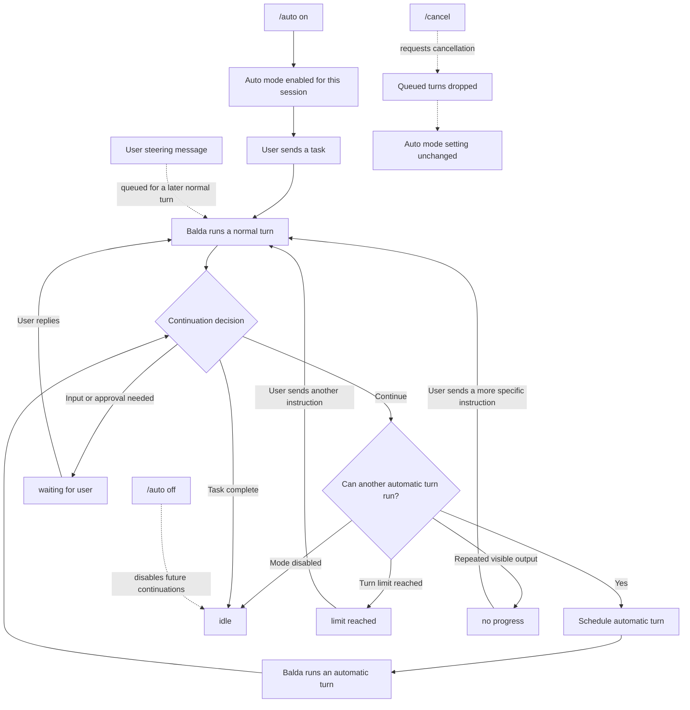

# Auto mode

Auto mode lets Balda continue a multi-step task without waiting for a new
message after every step. It is useful when a task needs several rounds of
investigation, editing, or verification and Balda already has enough
information to keep working.

Auto mode is off by default and belongs to one chat session. Enabling it in a
topic or thread does not enable it anywhere else. Participants using that session
share its Auto mode setting, conversation history, and tools. Automatic turns
use the same permissions as ordinary turns.

## Start and control Auto mode

1. Enable it in the session where you want to work:

   ```text
   /auto on
   ```

2. Send the task as an ordinary message. Enabling Auto mode does not start a
   task by itself.

3. Check its current state at any time:

   ```text
   /auto
   ```

4. Send an ordinary message to clarify or redirect the work without disabling
   Auto mode. If a turn is running, your message waits for a later normal turn;
   it does not interrupt the running turn.

5. Stop future automatic continuations when you no longer need them:

   ```text
   /auto off
   ```

Turning Auto mode off does not cancel a turn that is already running or queued,
including an automatic turn that has already been scheduled. Use `/cancel` to
request cancellation of the current conversational turn and drop queued turns
for this session. `/cancel` does not change the Auto mode setting. To stop
current work and future automatic continuations, send `/auto off`, then `/cancel`.

The `/auto` command is available to the owner and collaborators in Telegram,
Zulip, and Mattermost. Slack does not currently expose it. See the
[command reference](../commands.md#auto-auto-on-auto-off) for the command and
access matrix.

## How continuation works

After Balda completes a normal turn, Auto mode checks whether it can continue.
If it can, Balda schedules an internal continuation turn using the same session
runtime and delivers its visible response to the same conversation. The model
decides whether to continue, report completion, or wait for you. Internal
instructions and decision markers are hidden; completion and waiting decisions
produce a short state notification instead.



The chain stops when:

- the model reports that the task is complete;
- the model reports that it needs your input, clarification, or approval;
- the automatic-turn limit is reached;
- an automatic turn repeats the previous visible output after surrounding
  whitespace is removed; or
- Auto mode is disabled before the next continuation is scheduled.

Completion returns the state to `idle`. Completion, waiting for input, reaching
the limit, and repeated output leave Auto mode enabled. A later ordinary
message can start a new continuation chain in the same session, with a fresh
automatic-turn count.

## Read the status

`/auto` reports whether the mode is on, its current state, the automatic-turn
count and limit, a last-turn timestamp, and the last stop reason. These states
describe the continuation chain; `idle` after `/auto off` does not mean that a
running or queued conversational turn has been canceled.

| State | Meaning | What to do |
| --- | --- | --- |
| `idle` | Auto mode is off, awaiting a task, or has completed a chain. | Send a task, or use `/auto off` if you are finished. |
| `running` | Balda is working through the current chain. | Wait, or send a message to steer the next normal turn. |
| `waiting for user` | Balda needs information, clarification, or approval. | Reply with what is missing. |
| `limit reached` | The chain reached its automatic-turn limit. | Review the result and send a new instruction if more work is needed. |
| `no progress` | An automatic turn repeated the preceding turn's visible output, ignoring surrounding whitespace. | Give Balda a different or more specific next step. |

The default limit is **10 automatic turns** after the ordinary turn that starts
the chain. A deployment may configure a different positive limit with
`balda.features.automode.max_turns`; `/auto` shows the current session's limit.

Repeated-output detection only catches identical visible responses. It does
not decide whether two different responses made meaningful progress.

## Permissions and approvals

Auto mode uses Balda's normal session runtime and grants no additional
capabilities. When the model reports that it needs an explicit decision before
continuing, the chain enters `waiting for user`. This model decision is separate
from permission requests during a turn, which follow the deployment's
[permission review policy](../reference/configuration.md#agent-permission-review).
Enabling Auto mode does not enable approval prompts or change that policy.

For the technical state and continuation contract, see the
[Auto mode architecture](../architecture/auto-mode.md).

## Auto mode or GoalKeeper?

Use Auto mode when you want the current conversation to continue and you may
steer it with ordinary messages. Use [GoalKeeper](../goal-workflow.md) when you
want a durable goal with separate worker and validator sessions and its own
lifecycle. Auto mode does not start GoalKeeper or perform its separate
validation and export workflow. Stop GoalKeeper with `/goalkeeper clear`;
`/auto off` and `/cancel` do not stop a GoalKeeper run.
