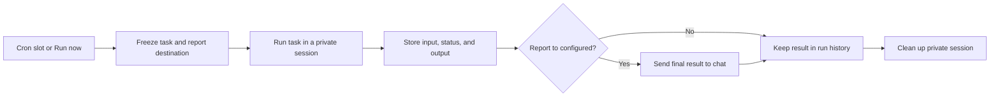

# Schedules

Schedules let Balda run a recurring task without a chat message. Each run starts
in a new private session, uses the configured agent and tools, stores its result
in Backoffice, and can optionally send the final report to a chat.

Use a schedule for work such as:

- preparing a daily engineering summary;
- reviewing dependency or security updates every week;
- checking a repository for stale work;
- generating a recurring operational report.

Schedules use five-field UTC cron expressions. They do not continue a chat
conversation or reuse its history.

## Before you start

You need:

- an administrator account in Backoffice;
- a configured agent provider for task execution; and
- optionally, a destination for the final report.

A report destination can be a public locator returned by `/locator` in a chat,
or a managed alias created on the Backoffice **Aliases** page. An alias such as
`main_chat` is easier to retarget later without editing every schedule.

## Create a schedule

1. Open **Operations → Schedules** in Backoffice.
2. Select **Create schedule**.
3. Enter a stable ID. It may contain lowercase letters, digits, `_`, and `-`,
   and cannot be renamed later.
4. Enter a five-field UTC cron expression.
5. Write the task instruction in **Content**.
6. Optionally enter a locator or managed alias in **Report to**.
7. Save the schedule. A newly created schedule starts enabled.

Common UTC cron expressions include:

| When | Expression |
| --- | --- |
| Every day at 09:00 UTC | `0 9 * * *` |
| Every Monday at 08:30 UTC | `30 8 * * 1` |
| On the first day of each month at 12:00 UTC | `0 12 1 * *` |

Write the content as a complete, self-contained instruction. A scheduled run
does not inherit a recipient chat's conversation, even when it sends the result
there.

## How a run works

The selected report destination is fixed when the run is admitted. Retargeting
an alias afterward affects later runs, not one already queued or running.

Only the final output or a bounded failure message is sent to the destination.
Progress updates and permission questions are not sent there. A task that needs
interactive approval cannot pause and ask the recipient; it fails closed.

## Run and monitor a schedule

Open a schedule detail page to see its next and last run times and newest-first
run history. Use **Run now** to start an extra run without moving the next cron
slot. Running a disabled schedule requires confirmation.

The history distinguishes scheduled and manual runs and shows states such as:

- queued or starting;
- running;
- delivering the report;
- succeeded;
- failed; or
- canceled.

Open an individual run to inspect its frozen task input, selected concrete
locator, durable agent output, and delivery state. A delivery failure does not
erase a successfully generated result.

## Change or stop a schedule

- **Edit** changes future runs and recalculates the next cron slot.
- **Disable** prevents future due slots from being selected. A run already
  admitted may still finish.
- **Enable** starts scheduling from the next future slot.
- **Delete** archives the schedule. Its detail and run history remain readable.

Schedules declared in `.config/balda/config.yaml` are visible but read-only in
Backoffice. Change them in configuration and restart Balda. Backoffice-managed
schedules and their enabled state survive restarts.

## Troubleshooting

### The schedule did not run at the expected local time

Cron expressions use UTC. Convert the intended local time to UTC and account
for daylight-saving changes outside Balda.

### The run failed before starting

Open the run detail for its bounded failure reason. Common causes include an
unavailable agent provider, an invalid or missing report alias, or temporary
runtime pressure.

### The task succeeded but no chat message arrived

Check the run's delivery state and selected locator. The output remains in run
history even when delivery is pending or failed. If **Report to** was empty,
no external message is expected.

### Editing an alias did not redirect an active run

This is expected. Each run freezes its concrete destination at admission. The
new alias mapping applies to later runs.

For configuration examples and the complete field contract, see
[Balda configuration](../reference/configuration.md). For operational and
durability details, see the
[job runtime reference](../reference/job-runtime.md#scheduled-job-runtime-semantics-internal)
and [Backoffice Schedules reference](../reference/backoffice.md#schedules-management).
To trigger tasks from external events instead, use [Webhooks](webhooks.md).
