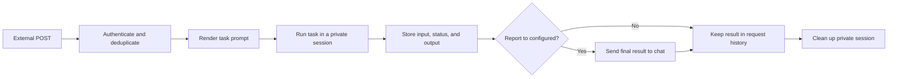

# Webhooks

Webhooks let an external system start a Balda task with an HTTP `POST`. Each
accepted request runs in a new private session, stores its input and result in
Backoffice, and can optionally send the final report to a chat.

Use a webhook to:

- summarize a deployment or monitoring event;
- review a payload from CI or an issue tracker;
- turn an incident notification into an actionable report;
- connect an internal automation to Balda without sharing a chat session.

Generic task webhooks are separate from Telegram, Slack, or other chat-provider
callback endpoints.

## Before you start

You need:

- an administrator account in Backoffice;
- a configured agent provider;
- a reachable shared HTTP listener; and
- optionally, a report locator or managed alias.

Set `balda.http.base_url` when Backoffice should display a complete public URL.
Without it, Balda shows the canonical root-relative webhook path. Keep the
listener on a private network or behind a trusted HTTPS gateway.

## Create a webhook

1. Open **Operations → Webhooks** in Backoffice.
2. Select **Create webhook**.
3. Enter a stable lowercase route name. It may contain letters, digits, `_`,
   and `-`, and cannot be renamed later.
4. Write a nonempty Go `text/template` in **Prompt template**.
5. Optionally configure **Report to** with a locator or managed alias.
6. Choose how duplicate requests are detected.
7. Optionally enable **Wait for report delivery before acknowledging the
   POST**. This requires a report destination.
8. Save the route and copy the generated secret immediately. It is shown only
   once.

The route starts enabled and receives requests at:

```text
<base_path>/webhooks/<route-name>
```

The prompt template can use these values:

| Value | Meaning |
| --- | --- |
| `{{ .RawBody }}` | Request body as received |
| `{{ .RequestID }}` | Stable request identity |
| `{{ .Path }}` | Canonical request path |
| `{{ .Method }}` | HTTP method |
| `{{ .Headers }}` | Request headers, excluding the credential header |

A minimal template is:

```text
Review this event and return a concise action plan:

{{ .RawBody }}
```

## Send a request

Managed routes authenticate with the generated
`X-Balda-Webhook-Secret` header:

```bash
curl --request POST \
  --header 'Content-Type: application/json' \
  --header 'X-Balda-Webhook-Secret: <secret>' \
  --header 'X-Request-Id: deployment-2026-10-25-api' \
  --data '{"event":"deployment_failed","service":"api"}' \
  'https://balda.example.com/webhooks/deployments'
```

Treat the secret as a credential. It cannot be read from Backoffice later. If
it is lost or exposed, rotate it on the route detail page; rotation immediately
invalidates the previous secret for new requests.

## How a request works



The report destination is resolved and frozen when a new request is accepted.
Only the final result or a bounded failure message is sent to chat. The private
execution does not inherit that chat's history, Auto mode, or session memory.

By default, a successful request returns `202 Accepted` after durable
admission. When delivery acknowledgement is enabled, repeat the same
idempotent request until Balda returns `200` after the report is delivered.

## Choose a deduplication mode

| Mode | Use when |
| --- | --- |
| Request ID | Reuse `X-Request-Id` across retries. |
| Header | The source already provides a stable event or delivery ID header. |
| Body SHA-256 | Identical request bodies should represent the same event. |

Retries of the same accepted request return the existing admission instead of
starting another agent run. Choose a header controlled by the event source,
not a value that changes on every retry. When `X-Request-Id` is omitted in
request-ID mode, Balda generates a new ID for each request.

## Test and monitor a webhook

Use **Test POST** on a route detail page to exercise the current prompt and the
same durable admission path without revealing or entering the webhook secret.
Testing a disabled route requires confirmation.

The newest-first request history includes accepted external and test requests.
Open an item to inspect its raw input, execution state, durable output, selected
report locator, and separate delivery state. Rejected requests do not create
history entries.

## Change or stop a webhook

- **Edit** changes new requests; already admitted work keeps its frozen route
  definition and destination.
- **Disable** rejects new external requests. Work already admitted may finish.
- **Rotate secret** replaces the managed route credential immediately.
- **Delete** archives the route and preserves its request history.

Routes declared in `.config/balda/config.yaml` are read-only in Backoffice and
require a restart after configuration changes. Managed routes take effect
without restart and survive process restarts.

## Troubleshooting

### The sender receives `401 Unauthorized`

Check the route's authentication header. For a managed route, use the current
`X-Balda-Webhook-Secret`; an older value stops working immediately after
rotation.

### The sender receives `404 Not Found`

Confirm the immutable route name, `balda.http.base_path`, and canonical
`/webhooks/<name>` path. Disabled and archived routes also reject new requests.

### The request was accepted but no chat report arrived

Open request history and check the selected locator and delivery state. The
agent output remains available even when delivery fails. If **Report to** was
empty, no chat message is expected.

### Retrying started unexpected work

Verify that the chosen deduplication value remains identical across retries.
Use a stable event-ID header when the sender changes the request body or its
own request identity between attempts.

For configuration-owned routes and complete response contracts, see
[Balda configuration](../reference/configuration.md) and the
[webhook runtime reference](../reference/job-runtime.md#inbound-webhook-contract-internal).
For Backoffice management details, see the
[Backoffice Webhooks reference](../reference/backoffice.md#webhooks-management).
For time-based automation, use [Schedules](schedules.md).
